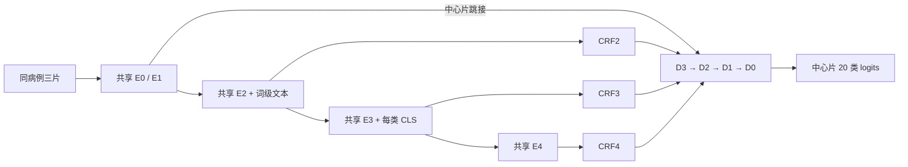

# ftp_next：SPIDER 脊柱 MRI 半监督分割（Frequency SSL v3）

本仓库是研究原型。它用有限的矢状位切片标注和额外的无标注切片，训练脊柱 MRI 的 **20 类 2D 分割模型**，再按整卷重建 3D 掩膜。研究问题是：频率视图、相邻切片、固定组织文本、病例级参考片或参考图像—掩膜条件，能否改善单网络的整卷分割。

输出标签：`0` 背景，`1–9` 椎体，`10` 椎管，`11–19` 椎间盘。椎体和椎间盘使用数据集的相对编号。文本分支只使用背景、椎体、椎管、椎间盘四类组织语义，具体编号由 20 类分割头学习。

> 本 README 于 2026-11-27 根据仓库代码重写，修正了旧版中失效的行号锚点、指向未提交目录的链接和不准确的依赖说明。同日还把写死的本机路径改成了可以用环境变量覆盖，删除了重复提交的源码 zip，补全了依赖清单，并增加了 CPU 测试的 CI。

## 当前状态

| 方向 | 状态 | 依据 |
| --- | --- | --- |
| 频率双学生（v3 默认配置） | 已实现，早期实验已完成 | [v3 重构记录](docs/refactor_v3_20261021.md) |
| N0 三片邻片融合 | 已实现，是后续文本与病例上下文实验的对照组 | [上下文效率](docs/context_architecture_efficiency_20261106.md) |
| N7 编码器文本路由 | 已实现。200 轮配对实验**未通过**预设的双指标条件 | 见下文“实验结论” |
| 病例上下文 B/C | 已实现。B 在三种子配对中**低于**对照 A | [病例参考片补充实验](docs/case_reference_followup_20261116.md) |
| 参考图像—掩膜条件 v2 | 2026-11-25 实现，**只做了实验准备，尚未正式训练** | [实施说明](docs/reference_conditioning_20261125.md) |

**实验结论（来自开发验证集，不是 test 结果）：**

- N7 在 200 轮配对实验中，最佳验证主 Dice 为 81.2578%，比 N0 高 0.8635 个百分点，但 Union-present Dice 低 0.3750 个百分点，按预设条件判定为未通过。
- 病例参考片 B 在固定 6000 步最终 EMA、三种子配对下，平均主 Dice 比 A 低 1.0246 个百分点。

这两组数字的原始报告位于本地 `outputs/dual_text_long_review_20261113/report.md` 和 `outputs/case_reference_followup_20261116/report.md`。`outputs/` 被 `.gitignore` 排除，**仓库内无法核对这些数字**。

## 已知问题

使用或继续开发前请先看这一节。

1. **缺少几何清单。** 相对位置 C、参考条件 v2，以及头信息有误的历史影像的推理，都要用到 `data/spider_image_geometry_manifest.json`，但 `data/` 目录不在仓库中。在集群上需要另外拷贝这个文件，或用 `experiments/prepare_geometry_manifest.py` 重新生成。
2. **实验结果不在仓库中。** `outputs/` 被 `.gitignore` 排除，所以下文的实验数字和参考条件 v2 依赖的冻结 A 教师（`outputs/case_reference_20261112/screen/A/last.pt`）都需要另外同步。
3. **CI 只覆盖 CPU。** 标着 “CUDA required” 的测试在 CI 中会跳过，正式实验前仍需在 GPU 上跑一遍 `pytest tests`。

## 路径配置（换机器或上集群）

配置文件中的路径支持 `${变量}` 和 `${变量:-默认值}` 两种写法，由 [`freqssl/paths.py`](freqssl/paths.py) 在读取配置时展开。没有设置环境变量时，展开结果与原来写死的路径完全相同，所以原机器上什么都不用改。

| 环境变量 | 作用 | 未设置时的值 |
| --- | --- | --- |
| `SPIDER_PNG_ROOT` | 所有配置的 `root_path`（SPIDER PNG 根目录） | `/data/zhp/dateset_spine copy/spider/slice_png_order` |
| `REPO_ROOT` | 仓库内的 `data/`、`outputs/` 路径（几何清单、冻结教师、缓存） | 当前代码所在的仓库目录（自动获得） |
| `FTP_NET_ROOT` | 历史 FTP v2 的 BERT 和文本嵌入，以及 `tests/test_mean_teacher.py` 对照用的原始 FTP 源码 | `/home/zhp/ftp_net` |
| `TEACHER_PYTHON`、`STUDENT_PYTHON` | `run_prompt_context.py` / `run_prompt_revision.py` 中两个进程使用的解释器 | 原来的 conda 环境路径 |

在集群上一般只需要设置：

```bash
export SPIDER_PNG_ROOT=/cluster/path/to/slice_png_order
```

说明：

- 引用了未设置、又没有默认值的变量时会直接报错，不会悄悄变成空字符串。
- 检查点里保存的是展开后的路径，`--resume` 和 `evaluate.py` 读到的仍是训练时的值。评估时如果换了数据位置，可以用 `evaluate.py --root-path` 覆盖。
- `configs/frequency_three/plan.json` 是历史运行记录，里面的路径没有改。

## 目录结构

```text
freqssl/          v3 研发代码：配置、数据、模型、训练、推理、评估及各实验分支
configs/v3/       v3 配置（schema_version: 3）；reference_conditioning/ 为参考条件 v2 六组
configs/*.yaml    历史 FTP v2 与早期频率实验配置
experiments/      实验编排、探针、诊断与汇总脚本（run_*/launch_* 为入口）
prompt_teacher/   训练期外部组织提示教师（离线缓存）
tests/            单元测试与合成数据端到端测试
docs/             按日期记录的设计、实验协议和结论
figures/          论文用架构图及其生成脚本
train.py          训练入口：按配置的 schema_version 分派到 v3 或历史 v2
evaluate.py       整卷评估
predict_spine.py  对新 MRI 体积做分割
trainer.py, dataset.py, model/, config.py, losses.py   历史 FTP v2 兼容路径
```

## 环境与数据

项目记录的环境是 Python 3.10、PyTorch 2.0.1。依赖见 [`requirements.txt`](requirements.txt)。只有在重新导出 BiomedCLIP 文本资产时，才需要另外安装 `open_clip_torch`。

训练前把 SPIDER PNG 根目录设为 `SPIDER_PNG_ROOT`（见[路径配置](#路径配置换机器或上集群)），目录结构如下：

```text
<root_path>/<split>/image/SPIDER_<病例号>_<切片索引>_<总片数>.png
<root_path>/<split>/label/SPIDER_<病例号>_<切片索引>_<总片数>.png
<root_path 的同级>/mha/<split>/{image,label}/      整卷评估用的 MHA
```

train、valid、test 在病例层面互斥。标注预算按切片计算，标注池和无标注池可以共享病例。上下文训练要求每个入选病例都有完整片序。参见 [`freqssl/data.py`](freqssl/data.py)、[`freqssl/evaluation.py`](freqssl/evaluation.py)。

## 快速开始

在仓库根目录执行：

```bash
# 训练 N0 三片视觉对照组
python train.py --config configs/v3/context_efficiency_reference.yaml \
  --device cuda:0 --output-dir outputs/readme_n0

# 冒烟测试：8 步真实数据训练后做完整 valid 3D 评估
python train.py --config configs/v3/context_efficiency_reference.yaml --smoke-test --device cuda:0

# 暂停后按保存的学习率日程续训
python train.py --resume outputs/readme_n0/last.pt --device cuda:0

# 整卷验证（默认 valid；test 必须显式写 --split test）
python evaluate.py --checkpoint outputs/readme_n0/best.pt --split valid --network teacher1 --device cuda:0

# 分割一份新的 3D MHA / NIfTI；输出必须是一个尚不存在的 .mha 文件
python predict_spine.py --checkpoint outputs/readme_n0/best.pt \
  --input /path/to/spine.mha --output outputs/readme_prediction.mha --device cuda:0
```

- `train.py` 不带参数时读取 [`configs/v3/dual_frequency.yaml`](configs/v3/dual_frequency.yaml)。
- `predict_spine.py` 可直接换用 N7 的检查点。头信息有误的历史转换影像需要再传 `--geometry-manifest`，参考条件模型需要传 `--reference-teacher`（冻结的 A 权重）。详见 [无标签推理说明](docs/spine_label_free_inference_20261028.md)。

## 方案一览

| 方案 | 实际启用的路径 | 配置或入口 |
| --- | --- | --- |
| MT | 单切片 U-Net，学生由自身 EMA 教师提供伪标签 | [`mean_teacher.yaml`](configs/v3/mean_teacher.yaml) |
| N0 | 三片共享编码，自适应中心残差融合，Mean Teacher | [`context_efficiency_reference.yaml`](configs/v3/context_efficiency_reference.yaml) |
| N7 | N0 加 E2 词级 token、E3 每类 CLS、组织锚路由和差分残差 | [`run_dual_text.py`](experiments/run_dual_text.py) 的 `arm_config()`、[`run_dual_text_long.py`](experiments/run_dual_text_long.py) |
| 病例上下文 A/B/C | A 为三片视觉对照；B 加同病例中部参考片；C 给三片融合权重加相对位置偏置 | [`case_reference.yaml`](configs/v3/case_reference.yaml)、[`run_case_reference.py`](experiments/run_case_reference.py) |
| 参考图像—掩膜条件 v2 | 行先验 FiLM（P1）、位置键/图像键注意力（KV-pos/KV）、固定参考、受限 GT 课程 | [`configs/v3/reference_conditioning/`](configs/v3/reference_conditioning)、[`run_reference_conditioning.py`](experiments/run_reference_conditioning.py) |
| 频率双学生 | 学生 1 看原图，学生 2 看原图加 Haar 高频残差；两个 EMA 教师交叉提供伪标签 | [`dual_frequency.yaml`](configs/v3/dual_frequency.yaml) |
| 其他 v3 对照 | 纯监督、独立双学生、原图交叉伪监督（CPS）、OAR 顺序分支 | [`configs/v3/`](configs/v3) |

可选的 `method` 为 `supervised`、`mean_teacher`、`dual_independent`、`dual_cps`、`dual_frequency`、`dual_ordinal`。哪些选项可以组合由 `ExperimentConfig.validate()` 约束（[`freqssl/config.py`](freqssl/config.py)）。例如邻片上下文只支持单学生方法，病例上下文和参考条件都要求不带文本、提示和辅助损失的 adaptive Mean Teacher。

## 模型

### Backbone

视觉 backbone 是从零训练的**单通道 2D U-Net**（[`freqssl/models.py`](freqssl/models.py) 中的 `UNet`）。编码器每级由两组 `3×3 Conv → GroupNorm → LeakyReLU` 构成，经四次 `2×2 MaxPool` 下采样；解码器用最近邻上采样、卷积投影和跳跃连接恢复分辨率，最后用 `1×1 Conv` 输出中心片的 20 类 logits。下表以 `224×224`、基础宽度 32、最大宽度 256 为例：

| 编码级 | 单片特征 `C×H×W` | N7 中的用途 |
| --- | --- | --- |
| E0 | `32×224×224` | 中心片跳接到 D0 |
| E1 | `64×112×112` | 中心片跳接到 D1 |
| E2 | `128×56×56` | 词级文本注入，融合后跳接到 D2 |
| E3 | `256×28×28` | 每类 CLS 注入，融合后跳接到 D3 |
| E4 | `256×14×14` | 训练期组织对齐，融合后作为解码器输入 |

`StudentTeacherSystem` 为每个学生构建同构的 EMA 教师。

### 邻片融合（N0）

每个样本取同一病例的 `[上一片, 中心片, 下一片]`，序列首尾复制最近片。输入 `[B,3,H,W]` 展为 `[3B,1,H,W]` 后通过同一个编码器。E0/E1 直接取中心片，E2/E3/E4 各做一次中心残差融合（CRF），之后只解码中心片：

```text
F_out = F_center + gamma * (sum_j(w_j * F_j) - F_center)
```

`mean` 模式取等权平均。`adaptive` 模式拼接三片特征，经 `1×1 Conv(3C,3)` 和沿切片维的 softmax 得到逐像素权重。`gamma` 每级一个，初值为 0，因此初始输出等于中心特征。实现见 [`freqssl/slice_context.py`](freqssl/slice_context.py) 中的 `CenterResidualFusion`、`ContextUNet`。

### N7 文本路由与差分融合



四条固定组织描述用冻结的 BiomedCLIP 离线编码，取第 12 层的 768 维 token、有效 token 掩码、每类 CLS 和四个 512 维归一化文本锚。新训练从文本库初始化，检查点中保存这些张量。资产由 [`export_hierarchical_text_assets.py`](experiments/export_hierarchical_text_assets.py) 导出。

1. **组织路由。** 把每个像素的视觉特征投影到 512 维并归一化，与四个文本锚计算相似度，除以温度 `0.07`。E2/E3 用同一组 logits 计算四类路由权重，并在标注中心片上做组织对齐；E4 只在训练时计算组织 logits 用于对齐。
2. **E2 词级与 E3 句级。** E2 以视觉特征为查询，在每个组织的有效 token 内做 64 维注意力，再按组织权重混合四组响应；E3 直接按组织权重混合每类 CLS 对应的值向量。
3. **差分残差。** 输出为 `F + tanh(g) * (Phi(Q,Z) - Phi(Q,0))`，其中 `Z` 是混合文本响应，`Q` 是视觉查询。两次 `Phi` 共享卷积融合块，门 `g` 初值为 0。E2 修正后的特征进入 E3，E3 修正后的特征进入 E4，之后再做多片融合。

实现见 [`freqssl/encoder_text.py`](freqssl/encoder_text.py)（`EncoderSpatialText`、`alignment_logits()`）和 [`freqssl/dual_text.py`](freqssl/dual_text.py)（`DualSpatialText`、`DualTextContextUNet`）。

### 病例级上下文（B/C）

- **B（参考片）**：在三片之外加入采集序列第 `floor((N-1)/2)` 片，四片共享编码器，E2/E3/E4 融合卷积变为 `1×1 Conv(4C,4)`，每级仍只有一个 `gamma`。标签监督只作用于中心片。
- **C（相对位置）**：仍输入三片。根据可信影像方向和片序把中心片位置归一化到 `[-1,1]`（单片病例取 0），位置网络产生三路偏置，加到融合 logits 后再 softmax。训练时用几何清单核对 PNG 与影像片序，部署时直接从输入影像几何计算。

实现见 [`freqssl/case_context.py`](freqssl/case_context.py)。

### 参考图像—掩膜条件 v2（尚未正式训练）

在 A 的三片 CRF 输出（stride 8/16）上，用同病例参考片的图像生成 K、用“参考原图 + 冻结 A 教师的 20 类概率”生成 V，做行窗口限制的交叉注意力，经零初始化门注入；P1 则用沿 AP 方向平均的类别概率做 FiLM。部署分两阶段：冻结 A 先预测整卷并选参考片，条件模型再完成分割，因此需要两套权重。完整协议、晋级判定和开销统计口径见 [实施说明](docs/reference_conditioning_20261125.md)。

`run_reference_conditioning.py` 默认只准备实验（冻结源码、配置和清单），显式传 `--launch-prepared` 才会启动训练。正式 worker 要求 CUDA，不会回退到 CPU，也不会自动重试。

## 一次训练迭代

入口链路：`train.py → freqssl.cli.train_main() → engine.run_experiment() → engine.train_step()`。以 N7 筛查为例，使用 1496 张标注中心片和 2236 张无标注中心片，batch 为 4L+4U。

1. **取样。** `SpiderSliceDataset` 读取 PNG，影像双线性缩放、标签最近邻缩放，应用共享空间增强后逐片标准化。无标注片返回占位标签 `-100`。
2. **教师弱视图。** EMA 教师在 eval 模式、无梯度下处理无标注影像，输出 softmax 概率。Mean Teacher 用自身教师，`dual_cps` 和 `dual_frequency` 用另一学生对应的教师。
3. **学生强视图。** 加增益与噪声；无标注部分按概率做 CutMix，影像、教师概率和 C 的位置图使用相同的供体和矩形（[`freqssl/augment.py`](freqssl/augment.py)）。
4. **损失**（[`freqssl/objectives.py`](freqssl/objectives.py)）。
   - 标注片：`0.5 × CE + 0.5 × soft Dice`。
   - 无标注片：取教师 argmax 作为硬伪标签，前景置信阈值 0.80、背景 0.95，接受的背景像素权重 0.25。CE 的分母是全部无标注像素，权重在预热后线性增长。
   - N7 另加 `0.1 ×` 组织对齐 CE（按类别平衡，E2/E3/E4 平均）。
5. **更新。** 只对学生反传，逐网络裁剪梯度，AdamW 更新后用对应学生更新教师。EMA 首次更新直接复制学生参数，之后衰减系数逐步升到配置值 0.99。

频率双学生的第二路输入：Haar 低频由 `2×2` 平均池化和最近邻重建得到，`high = x - low`，输入为 `x + 0.5 * high`（`haar_components()`、`StudentTeacherSystem.make_view()`）。

## 推理与评估

**分割新影像**（[`predict_spine.py`](predict_spine.py)，核心在 [`freqssl/inference.py`](freqssl/inference.py)）：

1. `load_single_network()` 根据检查点内的配置和权重重建一个网络；半监督方案默认用 `teacher1`，纯监督默认用 `student1`。
2. 从影像头或与体素哈希绑定的可信清单确定矢状位，通过轴置换与翻转得到切片布局（[`freqssl/geometry.py`](freqssl/geometry.py)）。每片复现训练 PNG 的灰度量化，再缩放并标准化。
3. 单片网络分批前向。N0、N7、B/C 使用整卷滑窗特征缓存，每张切片只编码一次（[`freqssl/context_cache.py`](freqssl/context_cache.py)）。推理使用 FP32。
4. 取 argmax，最近邻缩放回原尺寸，逆转排列与翻转，写出保留 spacing、origin、direction 的 `uint8` MHA 和同名 JSON 记录。

**有标注数据评分**（[`evaluate.py`](evaluate.py)，核心在 [`freqssl/evaluation.py`](freqssl/evaluation.py)）：按完整病例重建 3D 掩膜，计算 Dice 和 IoU。主 Dice 先在病例内对 GT 中出现的前景类取平均，再对病例等权平均；`dice_union_present` 还计入 GT 中没有但被预测出来的前景类。训练按完整 valid 的主 Dice 保存 `best.pt`，`last.pt` 用于续训。

## 测试

```bash
pytest            # 在仓库根目录；也可以 python -m pytest tests，或在任意目录 pytest /path/to/ftp_next/tests
```

测试使用合成数据，不需要 SPIDER 数据。请用 pytest 运行：31 个测试文件中只有 14 个是 `unittest.TestCase`，`unittest discover` 会漏掉其余文件。根目录的 `pytest.ini` 和 `conftest.py` 负责把仓库根目录加入导入路径；缺了它们时，直接运行 `pytest` 会让每个测试文件都报 `ModuleNotFoundError: freqssl`。

2026-11-27 在无 GPU 的机器上用两套环境各跑了一遍，结果相同：228 个通过、24 个跳过、0 个失败。

- 环境一：Python 3.10.20、PyTorch 2.0.1、NumPy 1.26，与项目记录的环境一致。
- 环境二：Python 3.13、PyTorch 2.15、NumPy 2.5。

跳过的 24 个里，22 个是因为没有 CUDA，2 个是因为缺少原始 FTP 源码（设置 `FTP_NET_ROOT` 后可以运行）。GPU 上的确定性、缓存和续训检查都没有覆盖到。合成训练只能说明链路、梯度和恢复是正确的，不代表模型性能。

CI 配置在 [`.github/workflows/tests.yml`](.github/workflows/tests.yml)，push 到 main 或提交 PR 时会用 Python 3.10 + PyTorch 2.0.1 CPU 版运行上面的测试。

## 文档索引

`docs/` 下的文件按日期命名，记录每轮的设计和结论。常用入口：

- 重构与基础：[v3 重构](docs/refactor_v3_20261021.md)、[v3 验证](docs/refactor_v3_validation_20261021.md)、[长训练](docs/long_training_20261026.md)
- 双学生与频率：[双学生设计](docs/dual_student_design.md)、[频率双学生方案](docs/frequency_dual_plan_20261018.md)、[辅助损失](docs/auxiliary_losses_20261023.md)
- 顺序与编号：[OAR 设计](docs/oar_spine_20261027.md)、[顺序搬运](docs/ordinal_transport_20261029.md)、[因子优势](docs/factor_advantage_20261028.md)
- 上下文：[邻片上下文](docs/slice_context_20261030.md)、[上下文贡献](docs/context_contribution_20261105.md)、[病例参考片](docs/case_reference_20261112.md)、[补充实验](docs/case_reference_followup_20261116.md)
- 文本：[内部文本融合](docs/internal_text_fusion_20261106.md)、[分层文本设计](docs/hierarchical_text_fusion_design_20261108.md)、[文本证据与后续测试](docs/text_fusion_evidence_and_next_tests_20261110.md)、[架构与损失调研](docs/architecture_and_loss_research_20261112.md)
- 提示教师：[训练期外部提示教师](docs/prompt_context_20261103.md)、[提示修订](docs/prompt_revision_20261104.md)
- N7 实验协议：[短筛查](experiments/DUAL_TEXT_SCREEN.md)、[200 轮](experiments/DUAL_TEXT_LONG.md)
- 参考条件 v2：[实施说明](docs/reference_conditioning_20261125.md)

## 历史 FTP v2

根目录的 `trainer.py`、`dataset.py`、`config.py`、`losses.py` 和 `model/` 保留旧配置与检查点的兼容路径。当配置的 `schema_version` 不是 3 时，`train.py` 会走这条路径。说明见 [`docs/legacy_ftp_v2.md`](docs/legacy_ftp_v2.md)。
