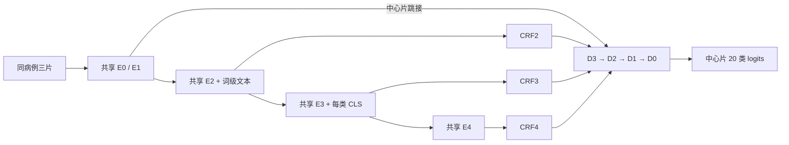

# Frequency SSL v3 · SPIDER 脊柱 MRI 半监督分割

本项目用有限的矢状位切片标注和额外无标注影像，训练脊柱 MRI 的 **20 类分割模型**。研究目标是验证频率视图、相邻切片、固定组织文本或病例级上下文能否改善单网络的整卷分割。部署从一份 MRI 体积和一个检查点生成原空间分割掩膜。

输出标签为 0 背景、1–9 椎体、10 椎管、11–19 椎间盘。椎体和椎间盘使用数据集的相对编号。文本分支使用背景、椎体、椎管、椎间盘四类组织语义，具体编号由 20 类分割头学习。

## 模型与配置

研发代码在 [`freqssl/`](freqssl)。[`train.py`](train.py) 根据配置的 `schema_version` 选择训练栈，无参数时默认读取 [`dual_frequency.yaml`](configs/v3/dual_frequency.yaml)。近期实验中的 N7 和病例上下文 A/B/C 有各自的入口。

| 方案 | 实际启用的路径 | 配置或入口 |
| --- | --- | --- |
| MT | 单切片 U-Net，学生由自己的 EMA 教师提供伪标签 | [`mean_teacher.yaml`](configs/v3/mean_teacher.yaml) |
| N0 | 三片共享编码、自适应中心残差融合、Mean Teacher | [`context_efficiency_reference.yaml`](configs/v3/context_efficiency_reference.yaml) |
| N7 | N0 加 E2 词级 token、E3 每类 CLS、组织锚路由和差分残差 | [`run_dual_text.py`](experiments/run_dual_text.py) 的 `arm_config()`，以及 [200 轮实验入口](experiments/run_dual_text_long.py) |
| 病例上下文 A/B/C | A 为三片视觉对照。B 加同病例中部参考片，C 给三片融合权重加相对位置偏置 | [`case_reference.yaml`](configs/v3/case_reference.yaml)、[`run_case_reference.py`](experiments/run_case_reference.py) |
| 参考图像—掩膜条件 v2 | 行先验FiLM、位置键/图像键注意力、随机/固定参考与受限GT课程；三种子确认后条件追加循环实验 | [实施说明](docs/reference_conditioning_20261125.md)、[`run_reference_conditioning.py`](experiments/run_reference_conditioning.py)，默认仅准备 |
| 频率双学生 | 学生 1 看原图，学生 2 看原图加 Haar 高频残差。两个 EMA 教师交叉提供伪标签 | [`dual_frequency.yaml`](configs/v3/dual_frequency.yaml) |
| 其他 v3 对照 | 纯监督、独立双学生、原图交叉伪监督、OAR 顺序分支 | [`configs/v3/`](configs/v3)、[`ExperimentConfig`](freqssl/config.py#L14) |

[`StudentTeacherSystem`](freqssl/models.py#L145) 为每个学生构建同构的 EMA 教师。[`ExperimentConfig.validate()`](freqssl/config.py#L89) 约束可用组合。N7 和 B/C 是独立的 Mean Teacher 实验，其中 B 和 C 也各自单独运行。

## Backbone 与网络前向

参考条件v2的部署分两阶段：冻结A先预测整卷并选片，条件模型再完成分割，因此需要两套权重。它的开销单独统计；其余上述单网络部署入口保持原用法。

视觉 backbone 是从零训练的 **单通道 2D U-Net**。编码器每级由两组 `3×3 Conv → GroupNorm → LeakyReLU` 构成，经四次 `2×2 MaxPool` 下采样。解码器用最近邻上采样、卷积投影和跳跃连接拼接来恢复分辨率，最后用 `1×1 Conv` 输出中心片的 20 类 logits。尺寸以参考配置的 `224×224`、基础宽度 32、最大宽度 256 为例。[`UNet.encode()` 和 `decode_features()`](freqssl/models.py#L80)

| 编码级 | 单片特征形状 `C×H×W` | N7 中的用途 |
| --- | --- | --- |
| E0 | `32×224×224` | 中心片跳接到 D0 |
| E1 | `64×112×112` | 中心片跳接到 D1 |
| E2 | `128×56×56` | 词级文本注入，融合后跳接到 D2 |
| E3 | `256×28×28` | 每类 CLS 注入，融合后跳接到 D3 |
| E4 | `256×14×14` | 训练期组织对齐，融合后作为解码器输入 |

N7 单个学生或教师的前向路径如下。E2/E3 的文本修正同时进入下一编码级和对应的邻片融合。



### 邻片融合

每个样本取同一病例的 `[上一片, 中心片, 下一片]`，序列首尾复制最近片。输入 `[B,3,H,W]` 展为 `[3B,1,H,W]`，三片分别通过同一个 2D 编码器。E0/E1 直接取中心片。E2/E3/E4 各自做中心残差融合（Center Residual Fusion，CRF），然后只解码中心片。

```text
F_out = F_center + gamma * (sum_j(w_j * F_j) - F_center)
```

`mean` 模式取等权平均。`adaptive` 模式拼接三片特征，经 `1×1 Conv(3C,3)` 和沿切片维度的 softmax 得到逐像素权重。`gamma` 是每级单独学习的标量，初始为 0，因此初始融合输出等于中心特征。[`CenterResidualFusion.forward()`](freqssl/slice_context.py#L24)、[`ContextUNet.forward_features()`](freqssl/slice_context.py#L84)

### N7 文本路由与差分融合

四条固定组织描述使用冻结的 BiomedCLIP 离线编码。模型读取第 12 层的 768 维 token、有效 token 掩码、每类 CLS 和四个 512 维归一化文本锚。新训练从文本库初始化，训练后的检查点保存这些张量。[`export_hierarchical_text_assets.py`](experiments/export_hierarchical_text_assets.py)、[`EncoderSpatialText`](freqssl/encoder_text.py#L16)

1. **组织路由。** 在文本注入前，把每个像素的视觉特征投影到 512 维并归一化，与四个文本锚计算相似度，再除以温度 `0.07`。E2/E3 用同一组 logits 计算四类路由权重，并在标注中心片上做组织对齐。E4 只在学生收集训练对齐时计算组织 logits。[`alignment_logits()`](freqssl/encoder_text.py#L64)、[`DualTextContextUNet._encode_chunk()`](freqssl/dual_text.py#L144)
2. **E2 词级与 E3 句级。** E2 以视觉特征作查询，在每个组织的有效 token 内做 64 维注意力，再按组织权重混合四组响应。E3 直接按组织权重混合每类一个 CLS 对应的值向量。[`stage_text_inputs()` 和 `attend()`](freqssl/dual_text.py#L43)
3. **差分残差。** 将混合文本响应记为 `Z`、视觉查询记为 `Q`。输出为 `F + tanh(g) * (Phi(Q,Z) - Phi(Q,0))`。两次 `Phi` 共享卷积融合块并参与反传，门 `g` 初始为 0。每片都执行相同操作，E2 修正后的特征继续进入 E3，E3 修正后的特征继续进入 E4，之后才执行多片融合。[`DualSpatialText.correction()`](freqssl/dual_text.py#L75)

### 病例级上下文

- **B（参考片）**在局部三片外增加采集序列的第 `floor((N-1)/2)` 片，四片共享编码器。E2/E3/E4 的融合卷积变为 `1×1 Conv(4C,4)`，仍由每级一个 `gamma` 控制整项残差。标签监督只落在当前中心片。[`reference_index()` 和 `CaseFusion`](freqssl/case_context.py#L13)
- **C（相对位置）**仍输入三片。根据可信影像方向和片序把中心片位置归一化到 `[-1,1]`，单片病例取 0。位置网络产生三路偏置，加到每级的内容 logits 后再做 softmax。训练时几何清单负责核对 PNG 与影像片序，部署时直接从输入影像几何计算。[`verify_dataset_geometry()`](freqssl/case_context.py#L32)、[`CaseFusion.forward()`](freqssl/case_context.py#L81)

## 一次训练迭代

入口链路为 `train.py → train_main() → run_experiment() → train_step()`。以 N7 为例，筛查使用 1496 张标注中心片和 2236 张无标注中心片，batch 为 4L+4U。标注预算按切片计算，两个训练池可以共享病例。train、valid、test 在病例层面互斥。[`build_training_data()`](freqssl/data.py#L273)、[`run_experiment()`](freqssl/engine.py#L329)

1. **取样与对齐。** `SpiderSliceDataset` 读取原图 PNG，将影像双线性缩放、中心标签最近邻缩放，应用共享空间增强，再逐片做均值和标准差归一化。未标注中心片只读取影像，返回占位标签 `-100`。[`SpiderSliceDataset.__getitem__()`](freqssl/data.py#L169)
2. **教师弱视图。** EMA 教师以 eval 模式、无梯度处理无标注影像。输入已过共享空间增强，输出 20 类 softmax 概率。Mean Teacher 使用自身教师的预测，`dual_cps` 和 `dual_frequency` 使用另一学生对应教师的预测。[`train_step()`](freqssl/engine.py#L86)
3. **学生强视图。** 对标注和无标注输入加入增益与噪声。无标注部分按配置做 CutMix，所有影像通道和教师概率图使用相同供体与矩形。C 的位置图也同步混合。学生在同一批强视图上输出 logits，N7 另收集 E2/E3/E4 的中心片组织 logits。[`strong_view()` 和 `aligned_cutmix()`](freqssl/augment.py)、[`forward_with_alignment()`](freqssl/encoder_text.py#L149)
4. **损失。** 标注中心片使用 `0.5 × CE + 0.5 × soft Dice loss`。无标注中心片取教师最大概率的类别作为硬伪标签，前景置信阈值为 0.80、背景为 0.95，接受的背景像素权重为 0.25。伪标签 CE 按全部无标注像素归一化，权重经预热后线性增长。N7 再加 `0.1 × 组织对齐 CE`，从标注中心片池化得到各尺度四类组织占比，按出现的组织类别平衡并平均 E2/E3/E4。[`segmentation_loss()`、`masked_pseudo_loss()`](freqssl/objectives.py)、[`tissue_alignment_loss()`](freqssl/hierarchical_text.py#L124)
5. **更新。** 只对学生反传并逐网络裁剪梯度，AdamW 更新后，再从对应学生更新教师。EMA 首次更新直接复制学生参数，随后衰减系数逐步达到配置值 0.99。N7 短筛查以 6000 步运行，伪标签权重预热 600 步、渐增 1200 步，每 500 步评估完整验证卷。[`train_step()`](freqssl/engine.py#L227)、[`update_teachers()`](freqssl/models.py#L284)、[N0–N7 筛查协议](experiments/DUAL_TEXT_SCREEN.md)

频率双学生的额外变换在 `make_view()` 中。Haar 低频由 `2×2` 平均池化和最近邻重建得到，`high = x - low`，第二路输入为 `x + 0.5 * high`。这条视图规则也用于选定第二路做推理时。[`haar_components()`](freqssl/models.py#L25)、[`make_view()`](freqssl/models.py#L240)

## 整卷推理与评估

**对新影像分割**使用 [`predict_spine.py`](predict_spine.py)，输入一份标量 3D MHA 或 NIfTI。流程如下。

1. **重建单个网络。** `load_single_network()` 根据 format-3 检查点内的配置和权重重建一套网络，半监督方案默认用 `teacher1`，纯监督默认用 `student1`。N7 直接恢复检查点内的文本张量，E2/E3 路由仍参与前向。[`load_single_network()`](freqssl/inference.py#L98)
2. **按几何取片。** 从影像头或与体素哈希绑定的可信清单确定矢状位，使用轴置换与翻转得到模型的切片布局。每片复现训练 PNG 的灰度量化，再双线性缩放、逐片标准化。上下文分支保留采集片序来组邻片。[`read_volume()` 和 `prepare_slice()`](freqssl/inference.py#L34)、[`sagittal_plan()`](freqssl/geometry.py#L37)
3. **按配置前向。** 单片网络分批直接预测。N0、N7、B/C 使用整卷滑窗缓存，每张实际切片只编码一次，多个目标窗口复用其特征。B 的中部参考特征跨窗口保留，C 的位置由影像几何和片序计算。之后逐批融合、解码，每个窗口只产出中心片。推理使用 FP32。[`iter_cached_logits()`](freqssl/context_cache.py#L9)、[`predict_volume()`](freqssl/inference.py#L161)
4. **恢复原空间。** 沿 20 类通道取 `argmax`，对标签做最近邻缩放，逆转切片的排列和翻转，写出保留 spacing、origin、direction 的 `uint8` MHA 及同名 JSON 记录。整个流程只读影像、检查点和需要时的几何清单。[`prediction_image()`](freqssl/inference.py#L207)、[`predict_spine.py`](predict_spine.py)

**对有标注数据评分**使用 [`evaluate.py`](evaluate.py)。v3 评估复用网络前向，按完整病例重建原生 3D 掩膜，与参考标注计算 Dice 和 IoU。主 Dice 先在病例内平均 GT 出现的前景类，再对病例等权平均。`dice_union_present` 也计入 GT 缺失但被预测出的前景类。训练按完整 valid 的主网络 Dice 保存 `best.pt`，`last.pt` 用于继续训练。独立评估默认 `valid`，测试使用 `--split test` 显式选择。[`evaluate_volumes()`](freqssl/evaluation.py#L136)、[`run_experiment()`](freqssl/engine.py#L329)

## 其他已实现模块

| 模块 | 关键代码和负责的路径 |
| --- | --- |
| 网络内部文本的其他接入位置 | `TextContextUNet` 在融合后的 E4 瓶颈接文本。`HierarchicalTextUNet` 在多个解码阶段做分层文本融合。`EncoderTextContextUNet` 对比单个 E2/E3/E4 位置的 token 或 CLS 注入。[`internal_text.py`](freqssl/internal_text.py)、[`hierarchical_text.py`](freqssl/hierarchical_text.py)、[`encoder_text.py`](freqssl/encoder_text.py) |
| 外部提示教师 | `TissueTeacher` 给出组织预测，`export_cache()` 离线生成缓存。训练端通过 `PromptCache`、`prompt_routed_loss()` 和可选的 `CompetenceGate` 把组织监督接入伪标签损失。[`model.py`](prompt_teacher/model.py#L81)、[`run.py`](prompt_teacher/run.py#L197)、[`prompt_supervision.py`](freqssl/prompt_supervision.py)、[`prompt_revision.py`](freqssl/prompt_revision.py) |
| 双学生辅助损失 | `masked_pseudo_dice_loss()` 计算筛选后的前景伪标签 Dice，`multiscale_region_loss()` 比较未混合视图下的多尺度区域关系，两项由配置权重控制。[`objectives.py`](freqssl/objectives.py)、[实验说明](docs/auxiliary_losses_20261023.md) |
| OAR 顺序与因子化 | `OrdinalUNet` 将第二学生的输出因子化为组织和相对编号。`train_ordinal_step()` 将交叉监督路由到细类、编号集合或组织。`ordinal_transport.py` 和 `factor_routing.py` 另用于编号搬运和融合探针。[`ordinal_model.py`](freqssl/ordinal_model.py)、[`ordinal_training.py`](freqssl/ordinal_training.py)、[`ordinal_transport.py`](freqssl/ordinal_transport.py)、[`factor_routing.py`](freqssl/factor_routing.py) |
| 诊断与几何 | 诊断模块用于测邻片贡献、视野位置敏感性和输入干预，几何模块负责切片方向变换及原空间恢复。[`context_diagnostics.py`](freqssl/context_diagnostics.py)、[`field_of_view.py`](freqssl/field_of_view.py)、[`geometry.py`](freqssl/geometry.py) |
| 历史 FTP v2 | 根目录 `trainer.py`、`dataset.py` 和 `model/` 保存旧配置和检查点的兼容路径。[`legacy_ftp_v2.md`](docs/legacy_ftp_v2.md) |

## 运行

在仓库根目录执行。项目记录的环境为 Python 3.10、PyTorch 2.0.1。依赖见 [`requirements.txt`](requirements.txt)，从原始影像推理还需安装 `matplotlib`。从头导出 BiomedCLIP 文本资产需要 `open_clip_torch` 和预先缓存的模型文件。[`export_hierarchical_text_assets.py`](experiments/export_hierarchical_text_assets.py)

训练前将配置中的 `root_path` 指向 SPIDER PNG 根目录。PNG 文件名为 `SPIDER_<病例号>_<切片索引>_<总片数>.png`，放在各 split 的 `image/` 和 `label/` 下。整卷评估另从 PNG 根目录的同级 `mha/<split>/{image,label}/` 读取对应的 MHA 数据。上下文训练所选影像池须提供每个入选病例的完整片序。[`data.py`](freqssl/data.py)、[`evaluation.py`](freqssl/evaluation.py)

```bash
# N0 三片视觉参考组
python train.py --config configs/v3/context_efficiency_reference.yaml \
  --device cuda:0 --output-dir outputs/readme_n0

# 整卷验证
python evaluate.py --checkpoint outputs/readme_n0/best.pt \
  --split valid --network teacher1 --device cuda:0

# 分割新 MRI。将输入路径换成影像文件，输出为新的 .mha 文件
python predict_spine.py --checkpoint outputs/readme_n0/best.pt \
  --input /path/to/spine.mha --output outputs/readme_prediction.mha --device cuda:0
```

推理命令可以直接换用 N7 的 `best.pt`。已知头信息有误的历史转换影像，另传 `--geometry-manifest data/spider_image_geometry_manifest.json`。暂停训练后可用 `python train.py --resume outputs/readme_n0/last.pt --device cuda:0` 按保存的日程续训。[`spine_label_free_inference_20261028.md`](docs/spine_label_free_inference_20261028.md)

N7 的成组复现实验用 `experiments/run_dual_text.py` 跑 N0–N7 短筛查，用 `experiments/run_dual_text_long.py` 跑 MT/N0/N7 的 200 轮对照。两者通过 `--banks` 指定包含 `text.pt` 的文本资产目录，`--output` 指定新目录，`--prepare-only` 只做实验准备并生成配置与冻结快照。病例上下文的复现入口与配置见病例参考片文档。[短筛查协议](experiments/DUAL_TEXT_SCREEN.md)、[200 轮协议](experiments/DUAL_TEXT_LONG.md)、[病例参考片协议](docs/case_reference_20261112.md)

## 实验记录

200 轮配对实验中，N7 的最佳验证主 Dice 为 81.2578%，较 N0 高 0.8635 个百分点，Union-present Dice 低 0.3750 个百分点。按预设的双指标条件，该轮筛查未通过。病例参考片 B 在固定 6000 步最终 EMA 的三种子配对验证中，平均主 Dice 较 A 低 1.0246 个百分点。两组数字来自开发验证集，报告保存在本地实验输出目录。[N7 长训练核验](outputs/dual_text_long_review_20261113/report.md)、[病例参考片复核](outputs/case_reference_followup_20261116/report.md)

早期频率实验、顺序模型和其他消融的背景见 [v3 重构记录](docs/refactor_v3_20261021.md)、[OAR 设计](docs/oar_spine_20261027.md) 和 [训练期外部提示教师](docs/prompt_context_20261103.md)。
