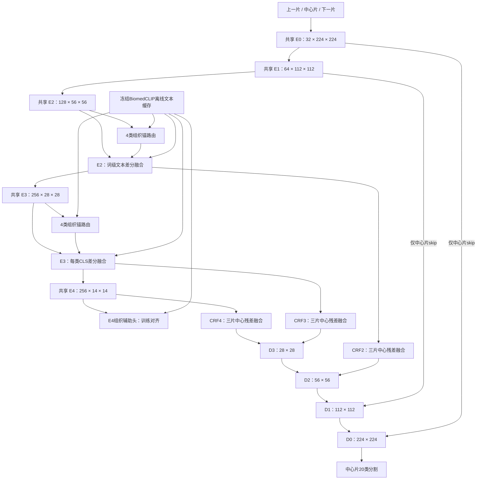

# 当前完整架构与损失函数研究候选

日期：2026-11-12。依据当前源码、N7冻结配置、2026-11-11完成的八组实验及2026-11-12核验记录整理；学术检索同日完成。本次交付为架构梳理、文献核查和候选设计，没有修改训练代码或启动实验。

## 1. 研究判断

可以把损失函数作为下一条研究线。最值得优先验证的是：**让组织语义路由、邻片上下文与最终20类分割之间传递可靠的监督。**

当前N7已经有三种目标：20类有标注分割、EMA伪标签监督、4类组织文本锚对齐。新目标应补充现有目标缺少的约束。简单叠加CE、Dice或把已有文本锚CE改称InfoNCE，不能构成新的机制。

建议优先级：

| 候选 | 核心问题 | 与现架构的关系 | 优先级 |
|---|---|---|---|
| A. 可靠性门控的跨粒度一致性 | 组织路由正确，是否能帮助最终分割；最终分割能否反过来改善路由 | 直接连接4类路由与20类输出 | 主创新候选，先做 |
| B. 同中心、不同邻片上下文的一致性 | 邻片提供帮助还是带来不稳定判断 | 直接利用共享编码和CRF | 架构匹配度高，第二阶段 |
| C. 组织界面的距离损失 | 椎间盘等组织的轮廓是否仍不准确 | 补充现有区域重叠损失 | 低成本参考，与A分开筛查 |
| D. 可靠区域原型对比 | 相似组织/边界特征是否缺少区分性 | 补充固定文本锚之外的视觉结构 | 中等优先级 |
| E. 语义等价提示一致性 | 文本收益是否依赖某一组词向量和措辞 | 检验双粒度文本分支的语义稳健性 | 后续候选，需要新增离线提示 |

这里的“主创新候选”是研究定位，不是已证实的新颖性或效果结论。下面区分论文已有机制、本项目已有实现和本次建议。

## 2. 当前完整架构：以N7为准

### 2.1 主线身份与输入输出

当前主线为 **三片共享2D U-Net + 自适应中心残差邻片融合 + E2词级/E3句级文本差分融合 + Mean Teacher**。源码入口为[dual_text.py](/home/zhp/ftp_next/freqssl/dual_text.py:133)，冻结实验定义为[DUAL_TEXT_SCREEN.md](/home/zhp/ftp_next/experiments/DUAL_TEXT_SCREEN.md)。

早期频率双学生、OAR双学生、外部组织提示教师、解码器分层文本是历史分支；N7没有同时启用这些模块。当前配置中的某些旧字段仍有默认值，不能据此把旧模块画进N7。

| 项目 | 当前实现 |
|---|---|
| 输入 | 同一病例有序矢状位三片：上一片、中心片、下一片；224×224；端点复制最近切片 |
| 编码 | 三片分别经过同一套单通道2D编码器，参数共享；不是三个独立网络，也不是3D卷积 |
| 视觉主干 | 从零训练的U-Net，四次下采样，GroupNorm，最近邻上采样加卷积 |
| 输出 | 只预测中心片，20类softmax |
| 类别 | 0背景；1–9相对编号椎体；10椎管；11–19相对编号椎间盘 |
| 粗粒度语义 | 20类可聚合为背景、椎体、椎管、椎间盘四组 |
| 文本 | 所有病例共享四条固定组织描述；没有病例报告、当前组织数量或绝对椎骨编号 |
| 半监督 | 一个学生、一个同构EMA教师；教师不反传；部署只需选定的一个网络 |

相对编号不能直接解释成L1/L5等绝对解剖名称。文本说明“是什么组织”，不提供“当前病例这是第几块椎骨”的额外真值。

### 2.2 单个学生/教师内部的数据流

E2文本修正后的特征继续进入E3，E3修正后的特征继续进入E4；它们同时作为对应层跳跃连接的来源。三片都执行相同文本操作。E4有组织对齐头，但没有文本注入。

这里的CRF指 **Center Residual Fusion**，不是条件随机场。对尺度ℓ的三片特征，其计算为：

\[
\alpha_\ell=\operatorname{softmax}_{\text{slice}}
\big(W_\ell[F_{-1}^{\ell},F_0^{\ell},F_{+1}^{\ell}]\big),
\qquad
\widetilde F_0^{\ell}=F_0^{\ell}+\gamma_\ell
\left(\sum_{j=-1}^{1}\alpha_{\ell,j}F_j^{\ell}-F_0^{\ell}\right).
\]

权重为逐空间位置的三片权重；γ从0初始化，是无约束有符号参数。只融合E2/E3/E4，E0/E1保留中心片细节。见[slice_context.py](/home/zhp/ftp_next/freqssl/slice_context.py:13)。

### 2.3 文本路由与差分融合

文本塔离线运行，缓存包括最后一层768维有效词token、每类一个768维CLS，以及四个512维最终文本锚。训练和部署使用嵌入检查点的缓存，冻结文本编码器不在线运行。

每个尺度的视觉特征经1×1投影和L2归一化，与单位文本锚比较：

\[
a_{\ell,t}(u)=\frac{\langle\operatorname{norm}(W^a_\ell F_\ell(u)),e_t\rangle}{0.07},
\qquad R_{\ell,t}(u)=\operatorname{softmax}_t(a_\ell(u)).
\]

**同一组组织logits同时用于类别路由和组织监督。** E2在每类内部做词token注意力，再用R混合四类文本响应；E3每类只有一个CLS，不存在有意义的类内词选择。视觉Q及文本K/V使用64维，K/V跨两个位置共享。

设混合文本响应为Z，局部融合块为Φ（3×3卷积→GroupNorm→GELU→1×1卷积），输出为：

\[
F'_\ell=F_\ell+\tanh(g_\ell)
\left[\Phi_\ell(Q_\ell,Z_\ell)-\Phi_\ell(Q_\ell,0)\right].
\]

两次Φ共享参数且都反传；门从0初始化。差分保证Z为0时修正为0，但不会自动证明修正携带医学语义。E3门为负是合法的有符号修正。见[路由与差分实现](/home/zhp/ftp_next/freqssl/dual_text.py:50)。

N7每网络保存6,419,395个参数，实际参与训练6,312,258；N0为5,688,640。这两个N7数字不应混用。E2/E3组织头是推理路由的一部分，不能把所有辅助头都当作可删除的训练专用模块；E4辅助头只在收集对齐时计算。

### 2.4 Mean Teacher与数据预算

教师处理弱视图，学生处理强强度增强；几何坐标保持对应。无标注CutMix对三通道采用同一供体和矩形，中心伪标签同步变化。教师目标停止梯度，学生更新后执行EMA；EMA系数逐步达到0.99。

当前6000步筛查使用1496张标注中心片和2236张无标注中心片，batch=8（4L+4U），AdamW初始学习率3e-4，每500步评估完整21例valid。这是**切片标注预算**，标注/无标注池可共享训练病例；train/valid/test病例分离。

推理按病例缓存共享编码，使每张真实切片只编码一次，随后组成相邻三片窗口解码。文本缓存、CRF和解码器均留在单网络内。

2026-11-12已启动MT/N0/N7各200轮、每组74,800步的配对长训练。本文读取的状态仍为运行中，不把未完成的长训练当作效果证据。协议见[DUAL_TEXT_LONG.md](/home/zhp/ftp_next/experiments/DUAL_TEXT_LONG.md)。

## 3. 当前损失的准确表达

\[
\mathcal L_{\mathrm{N7}}=
\underbrace{\tfrac12\mathcal L_{CE}^{L}+\tfrac12\mathcal L_{Dice}^{L}}_{20\text{类有标注分割}}
+\lambda_u(s)\underbrace{\mathcal L_{PL}^{U}}_{20\text{类硬伪标签}}
+0.1\underbrace{\frac13\sum_{\ell\in\{2,3,4\}}\mathcal L_{align,\ell}^{L}}_{4\text{类组织锚对齐}}.
\]

- **监督Dice**：平方分母形式，汇总batch和空间维后对全部20类平均，包含背景。不要描述为仅前景Dice。
- **伪标签CE**：前景最大概率≥0.80才接受；背景≥0.95，背景权重0.25。除以全部无标注像素数，不是接受像素数。λ在前600步为0，随后1200步线性增至1。
- **组织对齐**：只用有标注中心片的已有GT，把20类合为4类。先对one-hot面积池化，保留低分辨率格子的组织占比；每个组织按有效质量归一化，再平均本批出现的组织，最后平均三个尺度。没有读取无标注或邻片标签。
- **当前未启用**：额外伪标签Dice、区域Gram一致性、全局图像余弦蒸馏、中心化蒸馏、OAR顺序损失。

实现见[objectives.py](/home/zhp/ftp_next/freqssl/objectives.py:21)、[组织对齐](/home/zhp/ftp_next/freqssl/hierarchical_text.py:124)、[训练总目标](/home/zhp/ftp_next/freqssl/engine.py:151)。

对一个纯组织像素，当前组织目标为：

\[
-\log\frac{\exp(\operatorname{sim}(z,e_t)/\tau)}
{\sum_{k=0}^{3}\exp(\operatorname{sim}(z,e_k)/\tau)}.
\]

这已经是固定文本原型上的softmax对比形式；混合组织格子使用其软标签版本。**再添加相同特征、相同四个锚、相同标签的InfoNCE，只是在重复或重加权同一目标。**

## 4. 已有证据指出哪些问题值得优化

以下来自已完成的seed42、6000步完整valid实验。来源：[核验报告](/home/zhp/ftp_next/outputs/dual_text_review_20261112/report.md)。

| 对照 | 最佳Mean Dice | 最佳Union-present Dice |
|---|---:|---:|
| N0：三片视觉基线 | 80.3505% | 76.4926% |
| N1：只加组织辅助监督 | 80.1087% | 74.1386% |
| N7：完整文本路由差分融合 | 80.5709% | 78.8601% |

N7主Dice比N0提高0.2204个百分点，Union提高2.3675个百分点；主Dice仍未达到预声明的+0.3个百分点筛查门槛。N7最佳恰为6000步，不能把最佳与末步当两次独立验证。

与损失设计最相关的观察：

1. **额外组织监督本身未带来收益。** N1低于N0。A方案必须证明“路由—输出之间的连接”优于单纯再加辅助监督。
2. **依赖文本分支与理解文字内容并不等价。** 关闭E2/E3/两者，Dice分别下降2.4917/0.8205/3.6910个百分点；锚不变而错配类别文本仅下降0.2674。更大的错配退化也不能单独作为新目标成功的标准。
3. **末500步总体伪标签覆盖已达97.04%。** 不能继续把“大量像素被阈值丢弃”当作已证实的主要瓶颈；应检查前景、组织界面和稀有类的条件覆盖及错误率。覆盖率不是准确率。
4. **少样本编号仍有风险。** 椎体8在5个有效病例中下降约7.67个百分点，椎体9只有1例。应观察同组织编号错误，不能只追求合并组织Dice。
5. **对齐头与路由argmax一致率为1是定义上的一致。** 它们使用同一logits。对二者再加一致性损失会退化为零；应对齐的是独立的20类主头与4类路由。

历史上，额外伪标签Dice/区域Gram损失没有稳定超过单学生，早期OAR组织/编号集合路由也未通过筛查。新版本可以重测适配，但不能把已有机制重新包装成首次提出。相关记录：[辅助损失](/home/zhp/ftp_next/docs/auxiliary_losses_20261023.md)、[OAR设计](/home/zhp/ftp_next/docs/oar_spine_20261027.md)。

## 5. 五个候选设计

以下公式均为本项目候选，不是声称逐式复现所引论文。sg表示停止梯度；P为20类概率；R为4类路由；A将20类按组织求和；Dℓ表示面积池化至尺度ℓ。

### A. 可靠性门控的跨粒度一致性

**动机。** 当前R决定文本从哪里进入，但没有显式约束最终20类预测聚合后应与可靠的R相符。当前对齐只使用标注中心片，无标注分支的组织路由缺少直接目标。这是一个与融合结构紧密相关的缺口。

**最小版本。** 保留现有总损失，先在E2/E3建立两种可分别消融的传递方向：

\[
\mathcal L_{bridge}=
\frac12\sum_{\ell\in\{2,3\}}\frac1{|\Omega_\ell|}\sum_u
\left[
w^{out}_{\ell,u}\,KL\!\left(\operatorname{sg}[D_\ell A(P^T)]_u\,\Vert\,R^S_{\ell,u}\right)
+\eta w^{route}_{\ell,u}\,KL\!\left(\operatorname{sg}[R^T_{\ell,u}]\,\Vert\,[D_\ell A(P^S)]_u\right)
\right].
\]

第一项让成熟的最终分割教组织路由；第二项让可信组织路由教最终分割。两者不是要求两个可学习分支同时互相追逐的无门控对称KL。教师目标和权重均detach。

具体适配：

- 先比较第一项与增加第二项；若组织路由没有额外正确证据，η应保持0。
- 组织路由的温度为0.07，其softmax数值不能直接与主头置信度比较。用既有标注训练预算内预留的校准样本检查各自可靠性；不读取无标注GT，不用valid在线决定训练像素。
- 第二项优先作用于组织可靠而细编号未达到接受标准的位置。教师主头和路由明显冲突且可靠性不足时弃权，不能用低质量粗组织覆盖正确细类。
- 池化概率，不池化argmax。初版在组织内部较纯的格子使用；混合边界格子的高熵可能来自真实组织占比，不应自动被当成错误。
- 保留20类CE/Dice。四类监督不能辨别同组织内部的编号；因此不能单凭本项声称解决椎体编号错位。
- 分母保留全部像素/格子，记录实际覆盖。CutMix时目标、置信图和混合掩码必须同步，接缝混合格子单独处理；也可先在未混合分支验证。

更简单的组织集合伪监督为：

\[
\mathcal L_{set}=-\frac1{|\Omega|}\sum_u(1-m_{fine,u})m_{tissue,u}
\log\sum_{c\in\mathcal C_{\hat t_u}}P^S_c(u).
\]

它适合表达“确认是椎体，但不确定编号”。但项目的[marginal_set_loss](/home/zhp/ftp_next/freqssl/anatomy.py)已经有这一核心形式，它是简化参考对照，不应与bridge重复累加同一信号后宣称两项独立创新。

**文献依据。** Shi等的[Marginal loss and exclusion loss，MedIA 2021](https://www.sciencedirect.com/science/article/pii/S1361841521000256)支持对集合类别概率求和再监督；[U2PL，CVPR 2022](https://openaccess.thecvf.com/content/CVPR2022/html/Wang_Semi-Supervised_Semantic_Segmentation_Using_Unreliable_Pseudo-Labels_CVPR_2022_paper.html)说明不确定预测仍可能含有部分可靠信息。两者都不直接证明本项目的文本路由优于20类头。

**可能的贡献点。** 用实际进入融合的语义路由提供经可靠性选择的监督，并让20类输出改善路由，形成可消融的训练联系。普通KL、层级聚合和部分标签损失本身均为已有思想。

**关键对照。** N7；N7+普通跨粒度KL；N7+可靠性门控KL；必要时补相同接受像素数的随机/置信度掩码，区分“筛选更准”与“只是改变监督量”。报告路由→主头的净纠错数和覆盖，不只报告KL下降。

### B. 同中心、不同邻片上下文的一致性

**动机。** CRF学习三片权重，但当前伪标签可靠性只看一次教师预测。可以用同一个中心片在不同邻片条件下的预测稳定性，估计这份监督是否依赖脆弱上下文。

保留中心片，构造完整上下文及仅一侧邻片有效的上下文；缺失侧以中心片特征代替。三种预测始终对应同一中心坐标，不直接把相邻两片的同位置像素当成相同组织。

设教师完整上下文预测为Pfull，变体为Pv，对四类组织分布计算：

\[
d_u=\frac1{|\mathcal V|}\sum_{v\in\mathcal V}
JS\big(A(P^{T,full}_u),A(P^{T,v}_u)\big),
\quad w_u=\operatorname{sg}\left[m_u\exp(-d_u/\sigma)\right].
\]

学生在轻度上下文扰动下学习稳定目标：

\[
\mathcal L_{context}=\frac1{|\Omega|}\sum_u w_u
KL\left(\operatorname{sg}[A(P^{T,full}_u)]\,\Vert\,A(P^{S,v}_u)\right).
\]

可以复用三片编码，再执行少量融合/解码前向；训练计算会增加，推理仍为原单网络。先在组织粒度做，细编号仍保留原MT监督。只采用采集顺序一致的上下文扰动，不假设左右邻片可随意交换。

**文献依据。** [UA-MT，MICCAI 2019](https://arxiv.org/abs/1907.07034)支持按教师不确定性筛选一致性监督；[CCT，CVPR 2020](https://openaccess.thecvf.com/content_CVPR_2020/html/Ouali_Semi-Supervised_Semantic_Segmentation_With_Cross-Consistency_Training_CVPR_2020_paper.html)研究编码特征扰动后的预测一致性。这里的适配是把“同中心的邻片支持变化”作为可靠性来源。

**风险与判别。** 上下文变化造成分歧，也可能表示邻片提供了真实而必要的信息。若强行消除所有分歧，模型可能学会忽略邻片。需要“只有上下文扰动、没有新loss”控制，以及不加可靠性权重的KL控制；同时检查正常完整输入的Dice和CRF利用率。端点重复片、单片体积要排除无效扰动；CutMix接缝不用于计算解剖上下文稳定性。

### C. 组织界面的距离损失

**动机。** 当前CE/Dice主要优化分类和区域重叠。若误差诊断确认椎间盘边缘、椎体—椎间盘接口或椎管轮廓存在偏移，可以补充轮廓距离信息。较低组织Dice本身不能证明边界误差就是主因。

先只用标注中心片，将主头概率聚合为四类。对本片存在的前景组织t，从GT生成负内正外的符号距离φt，按固定半径截断归一化。可使用以下非负平移形式：

\[
\mathcal L_{surface}=\frac1{|\mathcal T_{present}|}\sum_{t\in\mathcal T_{present}}
\frac1{|\Omega|}\sum_u\bar\phi_t(u)\left[A(P^S)_t(u)-Y_t(u)\right].
\]

它与符号距离乘预测概率的Boundary Loss相差一个与模型无关的GT常数；截断和按组织归一化是本项目适配。无该组织的切片跳过其距离项，误检仍由原CE/Dice约束。

**文献依据。** [Boundary loss for highly unbalanced segmentation，MIDL 2019](https://proceedings.mlr.press/v102/kervadec19a.html)把轮廓距离写成可作用于softmax输出的区域积分，可与Dice配合。它可作为可靠的已知方法基准；仅添加该项的创新性有限。

**实施与验证。** 第一轮不从伪标签生成距离真值，避免把错误轮廓蒸馏成强约束。距离图须与增强后的标签几何一致；若在224网格计算，称为网格单位距离。正式评价可增加原生空间HD95/ASSD/表面Dice，但目前评估器没有这些指标，需另行实现并固定物理间距、容差及空类规则，不能声称已经测得。

不建议直接给全部脊柱前景增加“必须连通”的先验。[clDice，CVPR 2021](https://openaccess.thecvf.com/content/CVPR2021/html/Shit_clDice_-_A_Novel_Topology-Preserving_Loss_Function_for_Tubular_Structure_CVPR_2021_paper.html)主要针对管状结构的骨架/拓扑保持；椎体和椎间盘天然是多个分离结构。若之后研究椎管连通，必须先核对视野截断和标注拓扑。

### D. 可靠区域原型对比，而非重复文本锚CE

**动机。** 固定文本锚提供四类语义方向，无法代表当前MRI中同类组织的全部外观。可以从标注组织或可靠教师区域形成视觉原型，提供新的像素—区域关系监督。

最小版本使用一个训练辅助投影空间，维护每个组织的少量视觉原型。先由标注样本初始化，缺失类不更新；后续仅允许高可信无标注区域进入。每类平衡采样，重点选择易混淆界面附近但标签可信的像素。对像素z及其正原型集合P+：

\[
\mathcal L_{proto}=-\frac1{|\mathcal Q|}\sum_{z\in\mathcal Q}
\log\frac{\sum_{\mu\in\mathcal P^+(z)}\exp(\operatorname{sim}(z,\operatorname{sg}\mu)/\tau_p)}
{\sum_{\mu\in\mathcal P^+(z)\cup\mathcal P^-(z)}\exp(\operatorname{sim}(z,\operatorname{sg}\mu)/\tau_p)}.
\]

真正新增的是**来源于实际区域、可保留类内变化的视觉原型和采样关系**。如果仍使用原来的四个固定文本锚作唯一原型，就回到了现有对齐目标。

**文献依据。** [ReCo，ICLR 2022](https://github.com/lorenmt/reco)使用区域对比及困难负样本；[Textmatch，MICCAI 2024，§2 PGCL](https://papers.miccai.org/miccai-2024/paper/0960_paper.pdf)已用有标注前景/背景特征建立EMA原型，再用伪标签引导像素对比。因此“加入原型对比”本身不能主张首创。

**本项目边界。** 把所有椎体特征拉到一个点可能损害编号区分，应使用辅助投影、保留类内多样性并检查同组织编号错误。细编号对比可作为后续独立实验，仅使用可信编号；不能把跨病例相同相对编号解释为同一绝对椎骨。记录原型样本量、更新时间、正确/错误配对裕度，而不只看平均余弦上升。计算与存储成本高于A/C，需单独报告。

### E. 语义等价提示一致性与软对比

**动机。** 当前四条提示在所有病例完全相同，模型可能学到稳定的四类代码，而不是能迁移的语言语义。可以让语义等价、措辞不同的同类提示产生一致结果，检查文本分支对含义的稳健性。

离线为每个组织准备少量准确同义描述，保持组织对应，不加入病例不存在的数量、位置、绝对编号或成像序列亮暗假设。为隔离变量，第一版保持512维路由锚不变，只替换E2/E3的词/CLS内容；教师用原提示，学生抽取同义提示。

\[
\mathcal L_{prompt}=\frac1{|\Omega|}\sum_u w_u
KL\left(\operatorname{sg}[P^T(x,T_0)_u]\,\Vert\,P^S(x,T_{para})_u\right).
\]

所有空间增强和伪标签掩码仍须对应。已有主分割和组织目标保留，部署可继续只用原提示，不增加多次推理。

**文献依据。** [Textmatch，MICCAI 2024](https://papers.miccai.org/miccai-2024/767-Paper0960.html)已经使用图像/文本扰动的一致性，因此这首先是参考适配。[MedCLIPSeg，CVPR 2026，§3.4](https://arxiv.org/html/2602.20423v1#S3.SS4)用文本相似性软目标缓解相近描述的硬负样本问题；[C2Seg，ICLR 2026](https://proceedings.iclr.cc/paper_files/paper/2026/hash/5a8a65248b58794b53ab0f1b4587860d-Abstract-Conference.html)同样讨论重复临床描述造成的错误负样本。

**重要适配限制。** 我们不同病例共用同一文本库，不能把batch里的其他病例文本自动当负例。若相同文本用于所有病例，文本相似性目标会失去区分病例的能力；直接搬运病例级图文InfoNCE或上述批次软目标不合适。应把同组织的多个措辞视为多正样本，在组织/区域层面建立关系。

只要求同义提示不改变输出，也可能让网络完全忽略文本。因此要同时报告未见同义改写的表现、正确组织对应、正常分割收益和固定检查点干预。不要通过显式训练错误文本分支变差来制造“语义利用”证据。该方向改变提示因素，适合放在A/B机制明确之后。

## 6. 推荐实验次序

### 6.1 先做能排除错误方向的诊断

利用冻结N7，在原标注训练预算内选定诊断/校准子集，按组织内部、界面、稀有编号分别检查：

- 20类头聚合组织与E2/E3路由不一致的覆盖，谁对谁错；路由能提供多少“主头错而路由对”的区域。
- 细类低置信但组织正确的比例，以及已高置信却预测错误的比例。97%总体覆盖不能回答这些问题。
- 改变邻片支持后的稳定性是否与真实错误相关；若不相关，B的权重没有依据。
- 分割误差主要来自组织轮廓还是同组织编号错位。前者支持C，后者不能期待靠四类边界目标解决。

这一步是建议的下一项工作，本文没有执行新的数据推理或计算这些尚不存在的统计。

### 6.2 第一轮只改变损失

建议先做下列四组，沿用6000步筛查协议、相同初始化/划分/增强/选模规则；是否执行及预算另行决定，本次没有启动。

| 组别 | 变化 | 要回答的问题 |
|---|---|---|
| L0 | 原N7 | 同协议基线 |
| L1 | N7 + 普通跨粒度一致性 | 单纯连接两个输出是否有效 |
| L2 | N7 + 可靠性门控跨粒度一致性 | 可靠性选择是否优于普通KL |
| L3 | N7 + 标注组织界面距离损失 | 简单已知轮廓目标是否足以改善 |

先固定传递方向，再比较L1/L2；不要在门控实验中同时增加新提示、改位置或改路由结构。若A通过，再单独比较B的“扰动本身/普通KL/可靠性KL”，最后测试A+B是否互补。D/E不是第一轮必需项。

λ只作待验证超参数。对归一化后的新增项，可从0.01/0.05/0.1的小范围开始检查梯度量级，再固定少量候选；这些数值不是论文推荐的通用最优值。保留有监督目标，半监督新增项在教师稳定后渐增，避免一次叠加全部五项。

### 6.3 成功标准与证据

主指标继续使用病例等权、病例内GT存在前景类Mean Dice；同时报告Union-present、误检类/体素、合并组织Dice、同组织编号错误和逐类有效病例数。新增边界指标须按前述规范实现后才能报告。

保留最佳EMA和固定末步两个口径，但不能用末步替代预先指定的主选模标准。报告训练成本，尤其B的额外解码与D的原型构建。小幅改善仍需多种子、患者层面配对分析和未参与开发的评估确认；已反复查看的历史test不能包装成新的独立确认集。

若A改善，只能先说“语义路由与主头的可靠联系改善了训练”。要主张文本语义贡献，还需对照相同组织监督的无文本头/固定类别代码等条件。当前单个固定四类词表不能独立提供病例信息，损失函数也不能凭空创造这种信息。

## 7. 检索与参考阅读清单

本次为面向候选设计的定向学术检索，覆盖经典目标及2024–2026近作；不是系统综述或穷尽式新颖性检索。检索主题包括半监督组织/细类监督、文本原型对比、邻片可靠性、边界距离和文本语义一致性。使用作者、会议、期刊一手页面核查题名与机制，没有把搜索摘要中的性能数字移植为本项目的预期收益。

| 文献 | 已核查的机制与用途 | 本次阅读范围 |
|---|---|---|
| Li等，**Textmatch: Using Text Prompts to Improve Semi-supervised Medical Image Segmentation**，MICCAI 2024，[原文](https://papers.miccai.org/miccai-2024/paper/0960_paper.pdf) | MT、图文多视图一致性、视觉前景/背景EMA原型对比；D/E的直接参考 | 官方论文§2方法及§3任务设置，会议元数据 |
| Liu等，**Bootstrapping Semantic Segmentation with Regional Contrast**，ICLR 2022，[论文](https://arxiv.org/abs/2104.04465)、[官方代码](https://github.com/lorenmt/reco) | 区域对比和困难负样本；D的参考 | 作者摘要、论文检索节选与官方仓库方法/参数说明；OpenReview网页有访问挑战 |
| Wang等，**Semi-Supervised Semantic Segmentation Using Unreliable Pseudo-Labels**，CVPR 2022，[官方页面](https://openaccess.thecvf.com/content/CVPR2022/html/Wang_Semi-Supervised_Semantic_Segmentation_Using_Unreliable_Pseudo-Labels_CVPR_2022_paper.html) | 不确定像素可提供负类信息；A的相关思想，非层级路由复现 | 官方摘要及作者论文引言节选 |
| Shi等，**Marginal loss and exclusion loss for partially supervised multi-organ segmentation**，MedIA 2021，[期刊页面](https://www.sciencedirect.com/science/article/pii/S1361841521000256) | 合并类别的边缘概率监督；A的集合损失基础 | 期刊摘要/Highlights；未读付费全文 |
| Yu等，**Uncertainty-aware Self-ensembling Model for Semi-supervised 3D Left Atrium Segmentation**，MICCAI 2019，[作者版本](https://arxiv.org/abs/1907.07034) | 可靠性选择的一致性监督；B的基础参考 | 作者摘要与会议信息 |
| Ouali等，**Semi-Supervised Semantic Segmentation With Cross-Consistency Training**，CVPR 2020，[官方页面](https://openaccess.thecvf.com/content_CVPR_2020/html/Ouali_Semi-Supervised_Semantic_Segmentation_With_Cross-Consistency_Training_CVPR_2020_paper.html) | 编码特征扰动和主/辅助预测一致性；B的参考 | 官方摘要 |
| Kervadec等，**Boundary loss for highly unbalanced segmentation**，MIDL 2019，[官方页面](https://proceedings.mlr.press/v102/kervadec19a.html) | 由轮廓距离导出的softmax区域目标；C的基础参考 | 官方摘要及论文方法动机节选 |
| Shit等，**clDice – A Novel Topology-Preserving Loss Function for Tubular Structure Segmentation**，CVPR 2021，[官方页面](https://openaccess.thecvf.com/content/CVPR2021/html/Shit_clDice_-_A_Novel_Topology-Preserving_Loss_Function_for_Tubular_Structure_CVPR_2021_paper.html) | 管状结构的骨架/拓扑目标；用于明确C的适用边界 | 官方摘要及补充材料理论节选；不据此主张任意脊柱拓扑保证 |
| Koleilat等，**MedCLIPSeg: Probabilistic Vision-Language Adaptation for Data-Efficient and Generalizable Medical Image Segmentation**，CVPR 2026，[作者全文](https://arxiv.org/html/2602.20423v1)、[会议条目](https://cvpr.thecvf.com/Conferences/2026/Videos) | 软图文对比，使用文本相似性构造软目标；E的近作参考 | 作者版本§3方法，重点§3.4；会议信息由会议列表及官方仓库交叉核对 |
| Gui等，**Towards Text-Mask Consistency in Medical Image Segmentation**（C2Seg），ICLR 2026，[官方页面](https://proceedings.iclr.cc/paper_files/paper/2026/hash/5a8a65248b58794b53ab0f1b4587860d-Abstract-Conference.html) | 聚类感知软对比缓解重复描述的错误负样本；E的近作线索 | 官方摘要；PDF超过本次抓取大小限制，没有将摘要阅读称为全文复核 |

最先精读：Textmatch §2（确认已有原型/文本扰动机制）、Boundary Loss（建立简单精度基准）、U2PL与Marginal Loss（明确不确定监督边界）、MedCLIPSeg §3.4（避免不适合固定提示的批次对比）。
