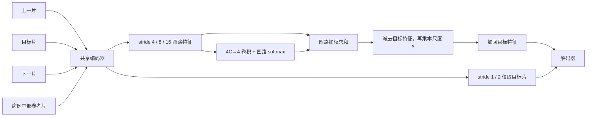

# 病例参考片：固定最终 EMA 的补充实验

本轮补充原三组筛查的机制证据，并按用户要求增加 A/B seeds43、44。与已有 seed42 合并为三组配对种子；每次均从头训练 6000 步，报告第 6000 步 `last.pt` 中的 EMA 教师，不使用验证最优检查点作为最终比较。仍在开发验证集上评价，不能把它当作独立 test 结果；本轮不读取 test。

## B 如何接入中心残差融合

这里的 CRF 指 Center-Residual Fusion。旧三路图只描述 A/C 的影像分支。B 的四路输入顺序为 `[F−, F0, F+, Fr]`，各尺度使用 `Conv1x1(4C,4)` 预测四张空间 logits 图，沿四路 softmax 得到和为 1 的 `[w−,w0,w+,wr]`。stride 4/8/16 的通道分别为 128/256/256，权重卷积形状为 `[4,512,1,1]`、`[4,1024,1,1]`、`[4,1024,1,1]`。

`Fout = F0 + γ(w−F− + w0F0 + w+F+ + wrFr − F0)`。

每个尺度只有一个共享 γ，B 没有独立的“参考片 γ”。等价系数是 `[γw−, 1−γ+γw0, γw+, γwr]`。γ 是不带 sigmoid/tanh 限制的可学习标量，初值 0；四路权重初值各 1/4。γ=0 时输出确实只用目标特征，不能仅看 softmax 权重判定参考片有贡献。

stride 1/2 高分辨率跳接仍只取目标片。四片共享编码器，参考片不新增分割监督。C 仍为三路，位置网络的输出加到三路 logits 后再 softmax。

## γ 和 w 的检查

原日志每 25 步记录学生 γ；完整轨迹导出 `gamma_student_trajectory.csv`。保存的 best/last 检查点教师 γ 单独导出 `gamma_saved_ema.csv`，不能把学生轨迹叫作 EMA 轨迹。

诊断对 B/C 的 best 和 last 分别运行完整 21 例 valid。best 仅用于解释之前的结果；新输入对照和最终比较使用 last。各尺度保存：

- γ、各路 w 以及有效系数的病例平均；
- 每例每路的均值、标准差、1/5/50/95/99 分位数，以及病例均值的分布；
- B 的 `γwr(Fr−F0)` 均方根相对目标特征均方根的比值。

收集器排除固定微批 8 的填充样本，权重统计不修改模型输出。全局均值对病例等权；图中的 w 是随影像与空间位置变化的预测量，并非固定参数。权重和残差范数只能说明内部使用强度，性能影响仍由输入干预检验。

## 新的输入干预

B：保留前三槽，只改变第四槽。

1. `reference_zero`：标准化后的第四张影像置零。编码器可能含偏置/归一化，因此不称为参考特征被彻底置零。
2. `other_case`：替换成另一 valid 病例的中部片。对病例建立无自配对的供体映射。
3. `same_case_random`：从同病例非中部索引均匀选一片；同一重复内，该片对该病例所有目标片保持一致。记录完整索引；允许与局部输入重复，单片病例只能重复原片。

C：对整个 valid 的位置值构造跨病例置换，所有供体均来自其他病例，所有位置值的总体分布保持完全不变。不同病例可能具有相同数值，报告实际改变位置值的切片数，不能把供体不同等同于位置数值一定改变。

三个随机对照各固定 seeds1701/1702/1703；控制随机数与模型训练种子独立。先在病例内平均重复结果，再做病例 bootstrap，不能把重复置换当作独立病例。供体/随机片选择只依赖影像清单和位置，参考标签不参与输入或选择。记录全部映射用于复核。

## 配对训练与输出

从原实验冻结源码复制训练实现，新代码只增加诊断与编排。训练配置只改 seed 和输出路径。依次运行 seed43 A/B、seed44 A/B，保持 seed42 的训练步数、学习率、warmup/ramp、标注预算和增强。没有基于本次结果的提前停止或延长预算，也不套用原筛查晋级门槛。

程序运行后自动生成：

- `fixed_step_results.json`、`report.md`：各种子最终 EMA、三种子均值±样本标准差（ddof=1）；每种子的病例配对差值；先对同病例的三个种子差值取平均，再重采样病例的 95% bootstrap 区间。
- `per_class_dice.csv`、`per_class_mean_std.csv`：逐类 Dice、逐类 union-present、GT 支持病例数、缺失类别误检及对整体指标的贡献。
- `union_decomposition.csv`：每例 K 个 GT 存在类别、M 个 GT 缺失但预测出现的类别、GT 存在类别 Dice 之和 S。主 Dice 为 S/K，union-present 为 S/(K+M)。各类贡献相加可精确复现病例等权整体指标。
- `diagnostics/`：B/C 各尺度权重及新增输入对照；`controls.json` 保存随机供体和索引，`case_metrics.json` 保留每例逐类原始构成。

均值和标准差只在三个配对种子全部完成后作为完整结果报告；未完成时明确标为 partial。后台训练启动后不持续人工监控，日志、退出状态与报告自动保存。
