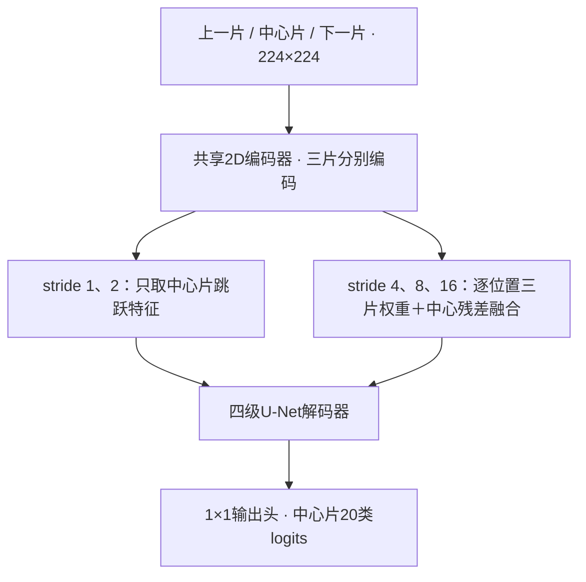
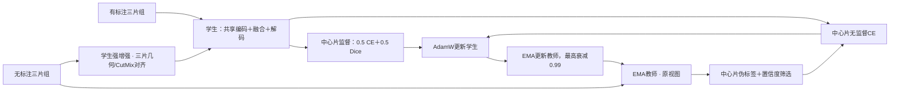

# 三片模型架构与计算优化

日期：2026-11-06。依据当前源码、历史训练结果、19例部分贡献诊断和本次实测；AI辅助整理。没有使用test进行开发。本轮完整筛查训练尚未启动，当前PyTorch环境CUDA不可用。

**现有证据不能证明三片训练最优。** 已有单片/三片的匹配训练证明了三片adaptive在当前设置中的潜力：6000步筛查主Dice提高0.5646个百分点；三种子30000步确认平均提高0.4313个百分点，但平均union-present下降，未通过原确认门槛。近期三片模型的替换、交换和远邻诊断是冻结模型输入依赖分析，且完整运行失败，只有19例共同通过核对。它既不能替代两片/五片模型的匹配训练，也不能证明更大模型无效。

若研究上下文最优范围，需要区分两条比较：同一宽度、相同步数的1/2/3/5片模型回答额外信息的收益；匹配计算或实测延迟的模型回答效率最优点。还要区分邻片数量与毫米覆盖范围。最多能声明在预先指定的候选、预算和数据中更优，不能声明普遍最优。本轮优先降低已有有效三片配置的开销。

**当前单网络架构。** `slice_context=adaptive`，输入为相邻三个矢状位灰度切片，输出中心片20类分割。三片使用同一套编码器权重，未使用RGB预训练。输入通道按原采集索引排列。



| 层级 | 空间分辨率 | 通道数 | 邻片参与方式 |
|---|---:|---:|---|
| E0 | 224×224 | 32 | 编码全部三片；跳跃连接只取中心 |
| E1 | 112×112 | 64 | 编码全部三片；跳跃连接只取中心 |
| E2 | 56×56 | 128 | 自适应融合 |
| E3 | 28×28 | 256 | 自适应融合 |
| E4 | 14×14 | 256 | 自适应融合后进入解码器 |

每级编码块是两次3×3卷积，各接GroupNorm和LeakyReLU；四次2×2最大池化降低分辨率。解码器四级输出通道为256、128、64、32，每级采用最近邻上采样、3×3通道投影、拼接跳跃特征，再经过两层3×3卷积块。最后1×1卷积映射到20类：背景、9个椎体编号、椎管、9个椎间盘编号。

**邻片模块。** 对每个融合尺度，令三片特征为F−、F0、F+：

```text
w = softmax(Conv1×1(concat(F−, F0, F+)))       # 3C → 3
Fused = F0 + γ × (w− F− + w0 F0 + w+ F+ − F0)
```

权重为每个空间位置三个标量，并在该尺度的特征通道间共享；三个尺度各有独立的权重卷积和可学习标量γ。γ初始为0，权重卷积初始为0；模型从中心片残差路径开始训练。γ没有被约束到[0,1]。模块参数分别为1156、2308、2308，总计5772。它已经具备动态空间加权能力。

**Mean Teacher训练架构。** 当前相邻切片实验是一个学生＋一个EMA教师，不是双学生频率模型。教师架构相同，不反向传播；推理只加载最佳EMA教师。



batch=8，其中4个有标注、4个无标注；标注预算1496/3732张中心片。相邻片只提供影像，不增加邻片标签监督。前景伪标签阈值0.8，背景0.95，背景损失权重0.25。当前对照不启用频率双分支、序数头、提示辅助监督、区域损失或伪标签Dice附加项。训练步数、标注数量与损失应在压缩对照中保持一致。

**参数和运算量实测。** 输入224×224，统计Conv2d的MAC；一次乘加记为1 MAC。未包含归一化、激活、上采样、softmax、逐元素融合和反向传播，因此不是完整训练FLOPs或延迟。

| 单个网络 | 参数数 | 学生一次前向/中心片 | 整卷编码缓存后的理想前向/中心片 |
|---|---:|---:|---:|
| 单片32宽度 | 5,682,868 | 11.607 G MAC | 11.607 G MAC |
| 三片adaptive32 | 5,688,640 | 17.191 G MAC | 11.613 G MAC |
| 三片adaptive24候选 | 3,202,040 | 9.685 G MAC | 6.542 G MAC |

“理想缓存”不计尾批填充，假设每张真实切片编码一次；实际eval固定微批次8，需要计入填充。学生训练的不同增强三片组不能直接复用跨样本编码缓存。上表学生前向也不包含教师前向和反向开销。

原adaptive32参数分布：编码器2,353,312（41.37%），解码器3,328,896（58.52%），分割头660，融合5772（0.1015%）。仅融合权重卷积的MAC约0.00587 G，主要计算在主干。三片共享参数，不能把三片模型参数数误记为单片的三倍；训练时学生和教师各存一份，部署时只需一份。

**已实现的缓存优化。** 新增`freqssl/context_cache.py`，接入验证和单体积推理。原`slice_context.py`及其模型类、参数名称、训练forward均未改动，旧缓存函数保留作为对照。

1. 按固定8片对齐预取，只对体积最后一个编码批次填充。旧实现按输出窗口补充邻片，部分窗口会额外填充一个短编码批次。
2. stride1/2仅收集中心特征，通过expand视图满足现有解码接口，避免显式拷贝两个未使用的邻片特征。完整8片输出批次中，这两级特征组装由220.5 MiB降至73.5 MiB；尾批内部仍可能物化填充。预取会多保留少量后续切片，不能把这一局部拷贝节省当作整体峰值内存降幅。

按完整valid的21例、418张真实切片进行形状核算，编码槽位（含填充）由624降至496，减少20.51%；解码槽位维持496。卷积MAC总量由6.117 T降至5.760 T，减少5.84%。这不是全验证集延迟实测；实际耗时与拷贝、主机负载和硬件有关。现有整卷缓存本来已避免大部分重复编码，本轮只报告在其基础上的增量优化。

实测使用已有seed42最佳教师，选择验证集首例、最短和最长体积，仅读取影像，预热后交替运行两种实现各3次。逐例数值一致性、耗时、MAC、checkpoint及源码哈希见`outputs/context_efficiency_20261106/results.json`。CPU一致性不替代尚未运行的CUDA核验。

| 体积 | 切片数 | 原缓存中位耗时/s | 新缓存中位耗时/s | 最大logit差异 / 改变像素 |
|---|---:|---:|---:|---:|
| SPIDER_126 | 17 | 4.712 | 4.513 | 0 / 0 |
| SPIDER_174 | 14 | 3.621 | 3.236 | 0 / 0 |
| SPIDER_186 | 35 | 8.304 | 8.116 | 0 / 0 |

本次三例中位耗时降幅为2.3%–10.6%，不作隔离硬件基准或GPU速度承诺。34项相关测试中30项通过，4项CUDA测试因设备不可用跳过；包括新缓存一致性、原生体积重建、精确断点恢复以及较窄模型梯度/EMA更新。较窄模型测试使用合成小图，只验证训练链路。

**参数压缩候选。** 将通道从[32,64,128,256,256]调整为[24,48,96,192,192]，保留三片、三个融合尺度及全部监督机制：参数减少43.71%，学生前向卷积MAC减少43.66%。这是真实结构计数，尚无完整训练的准确率结果；不能宣称压缩后精度不变。

配对配置为`configs/v3/context_efficiency_reference.yaml`和`configs/v3/context_efficiency_width24.yaml`，仅通道数、输出目录不同。均为seed42、6000步，之后有需要再对最佳候选做42/43/44、30000步确认。相同seed并不意味着不同宽度网络可逐参数共享初始化。本轮不同时加入蒸馏、额外位置模块或其他损失。

压缩目标与增益目标分开：建议预先采用平均主Dice最多下降0.2个百分点、平均union-present不下降、参数和MAC至少降低30%的工程筛查门槛，并报告逐种子结果；这是待验证的效率折中标准，不是统计等效性或显著性检验。它不改写原方法增益所用的+0.3个百分点门槛。

CUDA可用后可运行以下命令；当前未启动长时间CPU训练：

```sh
MPLCONFIGDIR=/tmp/context-efficiency-mpl /home/zhp/.conda/envs/mamba/bin/python train.py --config configs/v3/context_efficiency_reference.yaml --device cuda:0
MPLCONFIGDIR=/tmp/context-efficiency-mpl /home/zhp/.conda/envs/mamba/bin/python train.py --config configs/v3/context_efficiency_width24.yaml --device cuda:0
```

源码依据：[模型](../freqssl/models.py)、[融合模块](../freqssl/slice_context.py)、[训练步骤](../freqssl/engine.py)、[优化缓存](../freqssl/context_cache.py)。历史证据：[三种子训练报告](../outputs/spine_slice_context_20261030_r2/report.md)、[部分贡献诊断复核](../outputs/context_atlas_20261105/review_20261106/review.md)。复现实测：[测量脚本](../experiments/profile_context_efficiency.py)。
