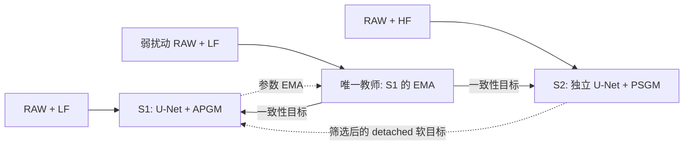

# 单教师双学生：结构决定与验证方案

日期：2026-10-15。范围：保留视觉从零训练、冻结 BERT、原 APGM/PSGM 运算和 SPIDER 分割任务；实现并验证独立双学生。这里的设计是待验证假设，不是性能结论。

## Material Passport

- Origin Skill: academic-research-suite / experiment-agent
- Origin Mode: architecture design + authorized code experiments
- Verification Status: PLAN; execution evidence is recorded separately
- Version Label: dual_student_v1
- 用户授权：梳理并确定双学生整体架构，然后尝试实验验证。此授权包含必要的代码实现和本地短程训练。

## 必须解决的问题与本版决定

| 问题 | 决定及原因 |
|---|---|
| 什么算两个学生 | S1/S2 各自持有独立 U-Net、解码器、BN 和可训练提示模块；不共享可训练参数。冻结的文本特征可以复用。 |
| 两个学生负责什么 | S1 接收 `[RAW, LF]` 并使用 APGM；S2 接收 `[RAW, HF]` 并使用 PSGM。两路都有 RAW，避免仅靠高频丢失结构信息。 |
| 教师与谁同构 | 教师是完整 S1（U-Net + APGM）的 EMA 副本。禁止把异构 APGM/PSGM 权重直接平均。BN buffer 从 S1 复制，教师始终 eval/no-grad。 |
| 教师如何吸收 S2 | S2 的 detached 软预测在筛选像素上监督 S1；S1 随后更新教师。S2 不直接写入教师参数。 |
| 谁监督 S2 | 自身真实标签监督、教师目标和原 intra-route 提示监督。 |
| 如何筛选反馈 | 仅未标注像素；S2 预测前景、置信度超过阈值，且比 S1 至少高一个 margin。用 KL(S2||S1)；零像素通过时反馈为可微零。置信度只是启发式，不能当作正确性证明。 |
| 是否强制学生不同 | 不增加“越不一致越好”的目标。保留输入/模块差异，并记录分歧与互补错误。 |
| 是否更改 APGM/PSGM | 模块内部不变；只更改所属网络和训练损失连接。保留原 CE/Dice 和 intra-route prompt loss。 |
| 可比性 | 各组 S1 初始参数、样本、增强、优化器、学习率和迭代数一致。S2 的初始化不得消耗 S1 使用的随机数流；损失不按学生数平均，避免改变 S1 梯度尺度。 |
| 评估谁 | 主结果为单教师 LF 路径，另报 S1、S2 和两个学生概率集成。集成收益与单教师收益分开。 |

每个学生的基础损失为原有标注 CE/Dice + 未标注教师一致性 + 原提示监督。仅 S1 额外接收 `lambda_feedback × masked_KL(stopgrad(S2), S1)`。反馈经过 warm-up/ramp-up；不读取未标注样本真实 mask。

这是有方向的双学生设计：教师以 LF/APGM 为主，HF/PSGM 通过反馈贡献知识。它不声称对两个学生对称。类似“两个异构学生、教师 EMA 跟随一个主学生”的先例见 [SDCL §2.2](https://arxiv.org/html/2409.16728v1#S2.SS2)；本次实验不用于宣称该拓扑新颖。

## 三组主要对照

| 标识 | 网络 | 反馈 | 要回答的问题 |
|---|---|---|---|
| anchor | S1 + T | 无 | 与双学生 S1 完全匹配的单学生基线 |
| dual_no_feedback | S1 + S2 + T | 0 | 额外学生没有反馈时，S1/T 应保持基线行为；S2/集成是否有不同表现 |
| dual_feedback | S1 + S2 + T | 启用 | S2 的预测是否能改善 S1 和单教师 |

现有共享 U-Net 双视图版本继续作为 `shared` 配置可用。它与 anchor 的训练输入和参数组织不同，不将二者差异单独归因于学生数量。

## 分层验证

1. 结构/梯度检查：参数无共享，教师无梯度，EMA 只跟随 S1；反馈只向 S1 反传，S2 target detach；未标注 GT 不影响损失；checkpoint 可重载。
2. 匹配负对照：对相同初始状态和批次，anchor 与 dual_no_feedback 的 S1/教师应保持一致。人为构造可靠分歧时，反馈须改变 S1 梯度。
3. 真实数据短程对照：三组相同训练预算、独立运行，预先固定训练/验证子集，保存样本清单、配置和源码 hash。只用 train/valid，不用 test 调参。
4. 完整验证：保持全量训练划分，至少三个种子，报告教师/学生 Dice、HD95、反馈覆盖率、学生分歧、耗时及显存。需要观察有效前景反馈，且教师收益跨种子稳定，才能支持实际性能收益。

## 首轮预实验（在结果产生前固定）

- 一个配对随机种子 42，三组各 240 次更新，batch=2（1 有标注 + 1 未标注）。
- 完整默认 224 输入、base_channels=32、768 维瓶颈及原文本特征；不缩小提示模块。
- 从原有标注池、未标注池分别均匀抽取 48/72 张训练切片；不根据 mask、损失或结果选择。
- 验证：最多 16 个患者，每个患者选择按文件名排序的中间切片；不使用验证标签挑样本。保存患者身份并检查与训练集无交叉。
- 同一学习率 1e-4、同一 240 步 polynomial schedule。每 48 步为一个预实验 epoch。
- 一致性 ramp-up 压缩为 1 epoch；反馈第 1 epoch 后启用，2 epochs ramp-up，权重 0.25、置信度阈值 0.5、margin=0.05、仅 S2 前景。各组基础损失日程完全相同。
- 压缩日程、切片子集、1 个种子和极短训练均限制外推。该预实验不能代替完整收敛实验，不将最佳一次结果当作有效性证明。
- 主比较为固定最后一步教师 Dice；checkpoint 只保存最后状态。记录 S1/S2/集成、反馈覆盖率和分歧，说明反馈是否实际启动。
- 运行时硬上限 30 分钟；若超过，只报告已完成部分，不用不等预算结果比较方法。先做 GPU 显存短测，资源不足则按事实记录并使用 CPU 可执行检查。

## 尚待实验证明的风险

S2 高置信度未必正确；可能通过错误反馈伤害 S1。背景占比高会掩盖学生差异，因此反馈和诊断需区分前景。LF 主教师可能偏向形状信息。多一个学生增加训练参数/显存；最终单教师部署与多学生集成必须分别评估。前景 Dice 为零或筛选覆盖率为零时，不能宣称机制有效。

## GPU 配对控制修正（2026-10-15，v2）

首轮 GPU pilot 已执行，但无反馈负对照的 S1/教师未保持一致，因此不用于反馈收益的因果结论。小张量复现实验确认：当前 PyTorch 2.0.1 的 `upsample_bilinear2d_backward_out_cuda` 不支持确定性反传；仅设置 cudnn.deterministic 不足以消除该随机性。

v2 保持上述模型、数据和超参数，启用 `torch.use_deterministic_algorithms(True)` 与 `CUBLAS_WORKSPACE_CONFIG=:4096:8`。严格模式下，训练的双线性上采样移到 CPU，autograd 穿过设备复制，仍采用原 bilinear/align_corners=False；推理保持 GPU。当前 CUDA 的二维 NLL reduction 也不支持严格模式，因此 CE 改用数学等价的 log_softmax + gather + mean。这些修正增加传输成本，不改为 nearest，不更改 APGM/PSGM。内核可能有浮点舍入差异，因此 v1/v2 数值不直接混合比较。

v2 在无反馈组结束后检查与 anchor 的 S1/教师状态；若不完全一致，保存失败证据并停止后续组。三个组顺序运行，只占用一个训练进程。按用户最新要求，确认后台启动后交接，完成后的指标核查和效果分析留待用户通知。
