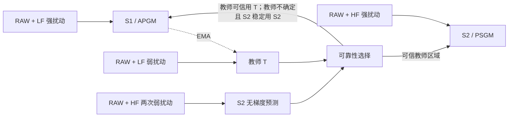

# 历史方案讨论：单学生与双学生的协作选择

此方案已被用户后续“先关闭 APGM/PSGM、验证频率双学生”的要求取代。当前实施见 [频率双学生方案](frequency_dual_plan_20261018.md)；下文保留此前机制讨论，不代表当前训练配置。

## Material Passport

- Origin Skill: academic-research-suite / experiment-agent
- Origin Mode: plan
- Origin Date: 2026-10-18
- Verification Status: 已核对当前源码、保存配置与结果 JSON；新方案 UNVERIFIED，未训练。
- Version Label: dual_student_v2_proposal
- 目标：在相同数据、训练更新数及推理网络预算下，让双学生训练提高最终 LF/APGM 单教师的完整病例 3D 分割性能。双网络集成另列。
- 本文是供讨论的模型与实验建议；保留从零训练的视觉网络、冻结文本特征及 APGM/PSGM 内部结构。

## 1. “单学生”实际上有两种

| 项目 | 旧版 shared | 配对基线 anchor | 当前 dual |
| --- | --- | --- | --- |
| 可训练视觉网络 | 一套共享 U-Net | 一套 S1 U-Net | 两套独立 U-Net |
| 输入 | RAW+LF、RAW+HF | RAW+LF | S1: RAW+LF；S2: RAW+HF |
| 提示模块 | APGM、PSGM 都有 | APGM | S1 APGM；S2 PSGM |
| 编码器/解码器/BN | 两视图共享，拼 batch 前向 | 仅 LF 路径 | S1/S2 各自独立 |
| EMA 教师 | 整个共享学生的副本 | S1 的副本 | 仅 S1 的副本 |
| 未标注教师目标 | LF 教 LF、HF 教 HF | LF 教师教 S1 | 同一个 LF 教师教 S1/S2 |
| 学生之间的信息传递 | 共享参数，两个视图的梯度一起更新 | 无 | 可选 S2 → S1 的筛选软目标 |
| 主要推理路径 | 教师 LF/APGM | 教师 LF/APGM | 教师 LF/APGM |

因此，`shared → dual` 同时改变参数共享、BN 统计、教师目标和模型容量，不能只归因为“多一个学生”。研究 S2 是否帮助 S1，应主要比较 `anchor → dual_no_feedback → dual_feedback`。

三者共同保留有标注 `0.4 CE + 0.6 Dice`、未标注教师概率 MSE、一条分支内部的 prompt→plain 硬目标监督，以及冻结 BERT/类别向量。监督项按分支求和，不按学生数量平均。

当前 dual 的信息路径是：`T → S1`、`T → S2`、`S2 → S1 → EMA(T)`。这是有方向的协作；不是两个学生对称互教，也不是两个学生的参数一起 EMA 到教师。两套 U-Net 主体结构相同，差异来自初始化、频率视图及提示模块，不能称为 CNN/Transformer 式的异构 backbone。

## 2. 历史实验记录已清理

按用户要求，旧训练日志、checkpoint、对应评估输出与指标表已删除。当前实验从无提示模块的频率对照重新开始，旧分数不再作为可复查的结果引用。

## 3. 当前机制的薄弱处

以下区分代码事实与待验证解释，尚不能把其中某一点认定为下降的唯一原因。

1. **学生尚未学会任务就开始反馈。** 第 48 步后开启反馈，而且全程只有 240 步；基础分割仍很弱。
2. **置信度差不能证明谁正确。** 当前仅比较两网 softmax 最大值，不检查校准、弱扰动稳定性或所选目标的真实准确率。两个独立网络的分数未必可直接比较。
3. **极少像素仍能产生较强反馈。** 当前 `sum(mask * KL) / max(selected, 1)`；选中 1 个像素也按完整的选中像素均值施加权重。低覆盖率不自动代表低梯度影响，需要记录反馈与基础损失的梯度范数。
4. **同一像素可能收到互相冲突的目标。** T→S1 的 MSE 在全部未标注像素计算，同时叠加 S2→S1 的 KL；S2 与教师不同意时，两项会拉向不同分布。
5. **S2 的互补能力没有显式验证。** 两个学生都被同一 LF 教师约束可能削弱差异，这是风险假设；当前极高分歧也说明尚不能断言发生了同质化。应测有效纠错率，而不是刻意增加分歧。
6. **前景筛选不等于边界专长。** HF 有助于细节只是设计动机，未证明 PSGM/HF 在椎间盘、边界或特定类别上更好。前景限定还能阻止 S2 用背景预测纠正 S1 假阳性。
7. **基础链路需要先站稳。** 少量样本、类别稀疏、从零训练及短日程均限制结论。先检查有标注小子集可过拟合、plain/prompt 的训练与 eval 表现，再建立全量训练池基线。

## 4. 可选协作机制

| 方案 | 如何协作 | 可能价值 | 主要风险/代价 | 本项目建议 |
| --- | --- | --- | --- | --- |
| 独立训练 + 概率集成 | 两学生各自学，推理平均 | 检查互补是否存在 | 推理两网，未改善单教师 | 必留诊断对照 |
| 可靠性筛选的单向反馈 | 稳定 S2 在可信区域教 S1；T 仍 EMA(S1) | 改动较小，部署一网 | S2 错误传递、覆盖不足 | 第一优先 |
| 双向 CPS | 两学生用 detached 硬伪标签互教 | 两边都能获益 | 早期互相强化错误、类别偏置 | 后续对照，不直接全图互教 |
| 双 EMA 交叉教学 | T1=EMA(S1)、T2=EMA(S2)，交叉教学生 | 两路都有时间平滑目标 | 四套模型常驻，目标更滞后 | 单向可靠反馈无效时再试 |
| 集成软目标蒸馏 | 预热后以两网/双教师的预测融合教主学生 | 尝试将集成收益压入单网 | 联合在线蒸馏可能循环自证 | 若稳定集成显著优于单网，优先试分阶段冻结供体 |
| 按区域/类别分工 | 根据可靠性分配结构、边界、类别监督 | 更贴合 LF/HF 初衷 | 分工可能错误，小类统计不稳 | 先证实分项优势，再增加 |

CPS 的原始方法以一网的 one-hot 伪标签通过 CE 监督另一网，并双向进行，见 [CVPR 2021 原文](https://openaccess.thecvf.com/content/CVPR2021/html/Chen_Semi-Supervised_Semantic_Segmentation_With_Cross_Pseudo_Supervision_CVPR_2021_paper.html)。按不确定性筛选教师目标可参考 [UA-MT](https://arxiv.org/abs/1907.07034)。两个学生与一个教师、用学生分歧定位潜在错误区域已有 [SDCL](https://arxiv.org/abs/2409.16728) 先例。上述文献用于机制参照，不是本文具体方案在 SPIDER 上有效或新颖的证据；本文不是完整文献综述。

## 5. 建议的 v2：单教师、双学生、延迟且有条件的纠错

继续保留 S1=RAW/LF+APGM、S2=RAW/HF+PSGM、T=EMA(S1)。第一轮只改训练目标的来源选择与反馈强度，不同时更换 backbone、增加第三路网络或特征对比模块。

### 5.1 目标产生与路由

记 `p1/p2` 为两学生强扰动预测，`qT` 为教师弱扰动预测，`q2a/q2b` 为 S2 两次弱强度扰动的预测，`q2=(q2a+q2b)/2`。几何坐标一致；所有目标和 mask 均 detach。

S2 的弱目标前向使用临时 eval/no-grad，随后恢复训练状态，避免额外更新 BN；不新增 EMA 教师。零反馈负对照跳过额外前向，或隔离它使用的随机数流，保持配对初始化与增强序列。

- `R_T`：教师置信度通过在 train 内标注校准集/valid 上预先确定的阈值。
- `R_2`：S2 两次弱预测类别一致、各自置信度通过阈值，且分布差异小。首轮仍只接收前景目标；背景纠错留作单独消融。
- `M_T = R_T`：S1/S2 只在这些像素接受教师一致性监督。
- `M_2 = (非 R_T) ∩ R_2`：只在教师不确定、S2 稳定的像素给 S1 额外反馈。
- 其余像素跳过跨网络伪标签；两方都高置信但互相冲突的像素，首轮维持教师路径，不以置信度差强行判 S2 胜。

这让 S1 的教师监督与 S2 反馈区域互斥，减少互相矛盾的拉扯。代价是不能纠正高置信错误教师；如果诊断发现这类错误占主导，再研究双教师/类别可靠性路由。高置信和扰动稳定都只是筛选依据，仍须以有标签诊断测准确率。

### 5.2 损失定义

保留每个学生原有 `L_sup` 与 `L_prompt`；保留教师一致性使用概率 MSE，只增加 mask。S1 的补充项为：

`L_fb = sum_u M_2(u) KL(stopgrad(q2(u)) || p1(u)) / max(sum_u M_2(u), rho * N, 1)`

`N` 是当前 batch 未标注像素总数。`rho` 是归一化分母下限比例，例如首轮候选 0.01；不是强制选满 1% 像素。空 mask 返回可微零。教师 mask 损失也须明确使用相同的分母下限约定，且对应 anchor 使用完全相同实现。

`L_total = w_sup(L_sup1 + L_sup2) + w_prompt(L_prompt1 + L_prompt2) + lambda_T(L_MT1 + L_MT2) + lambda_fb L_fb`

S2 反馈仅向 S1 反传；教师参数仍只跟随 S1。必须记录 `lambda_fb * L_fb` 和抽样统计的 S1 反馈/基础梯度比，不能仅看不同损失的数值大小。

### 5.3 训练阶段与初始超参数

建议将反馈进度改为 global step 占总更新数的比例，避免子集 epoch 与完整 epoch 的含义变化。

- 先预热：前 20% 更新关闭学生间反馈，使用配对一致的基础训练日程。
- 再渐增：之后 20% 更新将反馈从 0 平滑升至候选最大权重 0.05；与旧值 0.25 分开比较。
- S2 的置信度初始候选 0.8、两次弱预测 JS 散度候选上限 0.02（自然对数）；教师置信阈值初始候选 0.8。它们是待校准起点，不是已验证最佳设置。
- 用 train 内标注校准集或 valid 观察通过筛选的前景准确率和覆盖率，按类别报告。小类样本不足时不单独拟合复杂阈值，也不为提高覆盖率无条件降低阈值。
- 正式比较前固定阈值和启动日程，所有种子共用。若预热阶段目标仍不可靠，先结束诊断并修订下一次实验方案，不在同一轮反复根据表现临时改日程。

仅延迟或减小反馈也可能带来改善，因此不把整个改进包的结果归给某一个门控设计。

## 6. 实验顺序与判断标准

### 第一阶段：建立有效基线

先确认少量有标注数据可以明显降低监督损失并学到前景；比较 train/eval、plain/prompt 输出。若基础训练都学不好，先解决数据/优化/BN/提示路径问题。

然后使用完整既有训练池、固定标注预算，给 anchor 足量训练。可先以 10,000 更新作为学习曲线诊断预算，每 2,000 更新评估完整 valid 3D；这个预算不等于收敛保证。batch 根据显存确定后在所有对照中固定。

以病例为单位检查划分与类别覆盖；若改用患者级标注方案，应建立新的数据版本，所有组重跑，不能与原切片标注预算混比。保持未标注训练 GT 不可读。

### 第二阶段：逐项比较，避免一次换太多

| 编号 | 组别 | 用途 |
| --- | --- | --- |
| A | 原 anchor | 全量训练的基础参考 |
| B | 原 dual_no_feedback | A 的配对负对照；另报集成与互补性 |
| C0 | 原 dual_feedback | 在足量训练下重测旧机制，使用明确保存的日程 |
| C1 | C0 仅延迟反馈 | 区分启动时间影响 |
| C2 | C1 + 降低权重及分母下限 | 检查反馈强度；需要归因时再拆成两个子组 |
| D0 | 加可靠教师 mask 的 anchor | 为新教师门控提供匹配基线 |
| D1 | D0 对应的 dual_no_feedback | 验证教师门控下负对照仍严格一致 |
| D2 | D1 + v2 弱目标稳定性及互斥反馈 | 检验 S2 在新规则下的增量价值 |

先 seed=42 逐阶段筛选，不一次全启动。只有基础训练有效、S2 有可信目标的候选才扩展到至少三个预先固定种子，如 42/43/44。D2 要同时比较 D1 和 A；只优于一个变弱的 D1，不能称为整体提升。相同步数比较之外，补充相同 GPU 时间预算的 anchor，报告额外计算的收益。

### 评价与“提升”的定义

- 主指标：最终单教师的完整 valid 3D、每病例等权的前景 Dice；最终冻结选择后再评估 test。
- 次指标：3D IoU、HD95/ASD mm、漏检类-病例数、GT 缺失类的假阳性、union-present Dice，以及椎体/椎管/椎间盘分项。
- S1、S2、集成分别报告。集成更好是双网络推理结果；需进一步蒸馏验证才能算单教师收益。
- 固定 checkpoint 选择规则：同一评估时点网格，按完整 valid 3D Dice 选择 best，另报 last。不能用目前训练入口的 2D slice-best 代替 3D best。
- 候选成功标准：多种子平均单教师 Dice 高于匹配基线及原 anchor，报告每种子差值、波动与逐病例配对差值，并检查距离、漏检及小类没有明显恶化。实用增益门槛须在正式运行前约定；本文不事后指定“显著提升”。
- 21 个病例不足以支持任意细分的强结论；病例是评估独立单位，不能把 899 张 valid/test 切片当作独立样本。3 个种子也只能初步评估训练波动。
- 已有 test 结果只作历史披露，不据其选择阈值、方案或停止时点。新方案最终锁定后作一次 test 检验，并注明该 test 曾被历史实验查看。

### 必须补的诊断

按类别记录伪标签精确率、覆盖率、纠错像素率（S1 错/S2 对）、伤害像素率（S1 对/S2 错）和两者均错比例。真实准确率仅在允许读取标签的校准/验证数据上计算；未标注训练数据只记录预测统计。记录选择区域的分布，防止只覆盖某一个高置信类别。

如果 S2 在可靠性筛选后仍几乎不能纠正 S1，先增强/训练好 S2；如果稳定集成有收益但在线反馈持续无效，转向冻结供体的分阶段集成蒸馏，避免继续叠加在线损失。

## 7. 实现落点与当前范围

- `losses.py`：mask 教师一致性、互斥路由、带分母下限的反馈与分项统计。
- `trainer.py`：S2 弱目标前向、隔离随机数、global-step 日程及完整 valid 3D 选模。
- `config.py` / 新 YAML：新增参数和合法性检查，旧配置行为保持可复现。
- `experiments/compare_dual.py`：扩展实验组、保存实际日程/数据/源码与配对状态检查。
- `evaluate_volumes.py`：当前绑定三组 pilot，需要扩展为任意 checkpoint/组名；保留逐体素重建核验及三例 spacing 修正证据。
- `tests/test_dual_student.py`：反馈 detach、路由互斥、空 mask、稀疏梯度缩放、S2 目标前向不改 BN、零反馈负对照、checkpoint 重载。

本轮交付为现状梳理和模型草案，没有实现以上 v2 改动，也没有启动新训练。当前优先级是：有效 anchor → 可靠 S2 → 受控单向反馈 → 必要时集成蒸馏；能否提升由配对实验决定。
