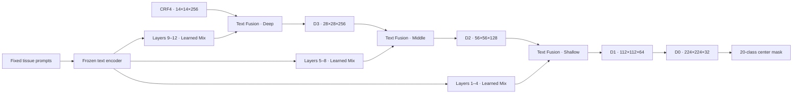

# 第二模块重设计：分层文本混合与组织对齐

日期：2026-11-08。2026-11-09更新：**原型已实现并完成短测试，尚未验证分割收益**。实现及测试结果见[原型报告](hierarchical_text_prototype_20261109.md)。以下保留初始设计依据。依据当前代码、上轮检查记录与本轮原文核查。用户要求的旧实验输出已删除，清理范围见[清理记录](internal_text_cleanup_20261108.json)。既有基线实验未删除。

## 判断

建议把单次 E4 文本注入改为 **E4、D3、D2 三处逐级融合**，同时让不同解码阶段读取文本编码器不同层的混合特征。仅给原来的同一向量复制三个适配器，无法验证“文本层级是否有用”。

上版存在两个可检验的设计限制：只使用最终池化文本向量；未直接监督图像位置与组织文本的对应关系。它们是改版动机，不是已被实验证明的失败原因。上一轮小幅负增益也可能与优化、统计波动或固定文本的信息量有关。

固定类别提示在训练和推理阶段都存在，但对所有病例相同。它们提供类别语义先验，不携带当前病人的结构数量、位置、病灶有无等新信息。增加文本层数不会自动增加这种病例信息。

## 原文依据及边界

1. **HiMix，WACV 2026**：[CVF会议页面](https://openaccess.thecvf.com/content/WACV2026/html/Hwang_HiMix__Hierarchical_Visual-Textual_Mixing_Network_for_Lesion_Segmentation_WACV_2026_paper.html)，[作者全文，§3.2–3.3](https://jaeyoonssim.github.io/publications/wacv2026/wacv2026_v1.github.io-main/static/wacv26_paper1.pdf)。论文提取语言编码器各层的token特征，按解码阶段分组并加权混合，随后逐级融合。它还包含频谱细化等组件。本提案借鉴其层级特征混合原则，不复制完整网络，不引入其频谱模块。CVF PDF访问返回403，方法核查使用作者发布的全文，发表信息由CVF页面确认。
2. **ABP，MICCAI 2024**：[官方全文，§2.1–2.2](https://papers.miccai.org/miccai-2024/paper/1674_paper.pdf)。其前三个文本引导解码阶段包含双向交互、文本token裁剪和文本先验引入，最后解码阶段不再前置ABP。它支持逐级交互这一设计方向，但不证明当前脊柱任务应使用同样层数或裁剪策略。
3. **Textmatch，MICCAI 2024**：[官方全文，§2](https://papers.miccai.org/miccai-2024/paper/0960_paper.pdf)。作为同构学生/EMA教师内部提示解码的参考。HiMix、ABP在此作为相邻的文本分割结构参考，不将它们称作当前MT方法的直接复现。

分层文本混合已有直接先例，不能把“多层加cross-attention”本身当作独立创新。可研究的问题是：固定组织提示条件下，分层文本与已有邻片上下文怎样配合，以及是否能形成可验证的组织对应关系。

## 三种候选与选择

| 候选 | 改动 | 能回答什么 | 当前取舍 |
|---|---|---|---|
| 多尺度复用最终文本特征 | 同一最终层token输入多个解码阶段 | 增加注入位置是否有用 | 必须保留为对照 |
| 文本编码器分层混合 | 不同隐藏层组对应不同解码尺度 | 文本表示层级是否有额外价值 | 优先设计 |
| 人工分层描述 | 类名、结构关系、局部形态使用不同文本 | 提示内容的层级是否有用 | 第二阶段，避免同时更换内容与结构 |

第一轮沿用背景、椎体、椎管、椎间盘四条固定组织句子。先改变**表示与融合方式**，不同时加入20类编号文本、额外报告、边界生成器或频率模块。

## 与现有解码器对应的接入位置

局部视觉流程为：



CRF2/CRF3与E0/E1的跳跃连接仍按原模型进入相应解码器，图中为简洁省略。三片视觉编码方式、中心片20类输出和原有三尺度CRF均不变。

| 接入特征 | 文本层组（1-based） | 本轮假设与作用 |
|---|---|---|
| CRF4之后、D3之前，14×14 | 9–12 | 深层组织语义调节 |
| D3之后、D2之前，28×28 | 5–8 | 中层图文对应细化 |
| D2之后、D1之前，56×56 | 1–4 | 保留更多词级表示，辅助区域细化 |
| D1、D0，112/224 | 不新增文本融合 | 由高分辨率视觉特征完成精细定位 |

**语言模型浅层不等于医学图像边界。** 上述对应是待检验的结构假设。低层语言token不能直接给出像素轮廓；轮廓依然来自影像。不得将“浅层词级表示→边界改善”写成既定事实。

## 文本缓存与混合

本地配置确认：BiomedCLIP使用12层、768维的BiomedBERT文本塔；现有离线向量是最终CLS经过MLP投影后的512维输出。这12层隐藏特征不能从原来的4×512向量还原。

新提案需从**同一固定BiomedCLIP检查点内的文本塔**导出 `output_hidden_states=True`，保留12层的 `4×L×768` token张量及有效token mask。跳过embedding层输出，排除padding，并明确特殊token处理。不能用另一个独立下载的原始BERT权重悄悄替换该文本塔。编码器冻结；固定文字只导出一次，训练和部署读取缓存。

每级在自己的四层组内进行混合，保留组织c与token j两个轴：

```text
alpha_l = softmax(MLP_l(GAP(F_l)))           # B×4, four encoder layers
T_l[c,j] = sum_k alpha_l[k] * Norm(H_k[c,j])
```

MLP末层零初始化，开始时组内均匀混合。这里的层权重可随输入影像变化；输入文字仍然固定。Norm用于控制隐藏层幅度差，不代表中间隐藏层已经与视觉空间对齐。逐级线性混合全句池化向量是更便宜的对照，但首个提案保留token以避免再次丢失词级信息。

## 类别绑定与融合形式

适配器使用64维Q/K/V。视觉Q与输出映射分尺度，文本K/V投影跨三个尺度共享，以限制容量并统一映射。对每个组织的有效tokens先计算类内注意力，再通过组织权重汇总；组织权重由该类tokens的`logmeanexp`相似度计算，以减少不同提示长度带来的token数量偏置。

```text
z_l[c,j] = dot(Q_l(F_l), K(T_l[c,j])) / sqrt(64)
s_l[c] = logsumexp_j(z_l[c,j]) - log(valid_tokens_c)
p_l = softmax_over_tissues(s_l)
r_l = sum_c p_l[c] * sum_j softmax_j(z_l[c,j]) * V(T_l[c,j])
F_l_out = F_l + tanh(g_l) * Wout_l(r_l)      # g_l starts at zero
```

通过训练时的组织辅助监督绑定p的四个通道：把现有有标注中心片20类GT映射为4类组织，再对one-hot做区域平均得到各尺度的软占比目标，使用软交叉熵。比直接nearest缩小硬标签更能保留低分辨率格子内的小组织信息。

`L = L_original_MT + lambda_align * mean_l CE_soft(p_l, pooled_tissue_GT)`。

第一版辅助损失只使用原来有标注的中心片，不读取无标注GT，也不另外构造无标注文本伪标签。原MT强增强/CutMix和20类伪标签损失保留。辅助监督允许零残差门时Q/K与层混合分支也收到训练信号；V与输出映射仍通过主分割路径学习。lambda_align必须在正式实验协议中固定，当前设计尚未宣称某个权重已最优。

辅助监督是新增因素，可能独立带来收益。必须安排同样组织监督的无文本/中性文本对照，不能把所有提升都归给文本。

教师包含同构模块；视觉投影、文本投影、层混合MLP和残差门一起做EMA。语言塔及缓存不做梯度更新。推理只需单个EMA网络和缓存，不需要标签或逐例报告。三组词级特征是推理输入，增加的注意力计算须实际计量。

## 最小判别实验

| 对照 | 目的 |
|---|---|
| A：原三片MT | 总体参考 |
| B：三尺度组织辅助头，无文本 | 衡量新增组织监督本身的收益；单列参数差异 |
| C：三尺度复用最终层token＋同样对齐损失 | 衡量多位置注入；投影维度与新模型一致，保留768维最终隐藏token，不混用旧512维池化输入 |
| D：分层混合真实组织文本＋对齐损失 | 主候选 |
| E：分层混合中性文本＋同样对齐损失 | 控制适配器容量与监督，判断真实组织文字是否有额外贡献 |

若D显示改善，再补D去掉对齐损失、各尺度共享全层混合、固定层组均值和相反层级顺序等消融；一次只改变一个因素。相反层级实验约束可读层组，不能让可学习层选择立即重新选择回原分组而失去对照意义。

所有比较采用相同标注划分、增强、seed与训练预算；原主指标保持病例等权前景Mean Dice，同时报告IoU、union-present、逐类样本数、缺失类误检、合并组织指标、参数与推理延迟。稀有类宏平均改善不能自动替代主指标。

实施前先检查：缓存形状与来源哈希、padding不参与注意力、缺失组织不会被强制预测、各尺度梯度、EMA、缓存整卷推理和断点恢复。可记录层权重与组织图，但注意力或层权重变化不能独立证明语义理解。固定文本仍可能退化为可学习类别基；这必须由真实/中性及参数对照评估。

初始交付为结构与验证设计。2026-11-09已执行原型短测试；完整MT性能验证尚未开始，不能将原型连通测试视为有效性验证。
