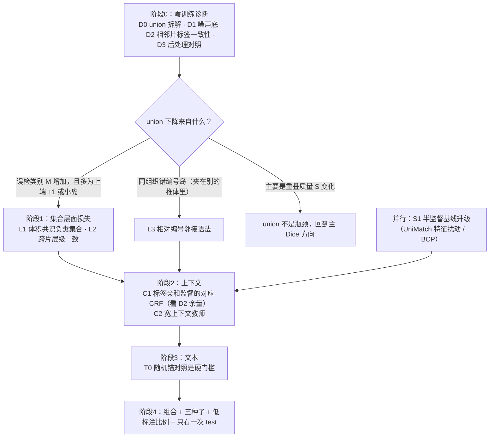

# 创新点路线图：损失、CRF/上下文、参考与文本、半监督流程

日期：2026-11-27。依据：`claud_research` 分支（head 6ab3260）的源码与 `docs/`、`experiments/*.md`，以及本次联网检索的 2019–2026 文献。**没有读取 `outputs/`（不在仓库），没有训练，没有在 GPU 上跑任何东西。** 正在服务器上跑的 seed42 KV-pos / NB-pos / JOINT-pos 不受本文影响；本次只新增了文档和两个只读诊断脚本。

标注约定：

- **[已核]**：我在仓库源码、文档原文或本地计算中确认的事实。
- **[文档称]**：仓库文档写的实验数字，原始报告在 `outputs/`，我无法复核。
- **[文献已读]**：本次实际打开论文正文（至少方法部分）核对过的机制。**[文献仅摘要]**：只读了摘要或元数据。
- **[推断]**：我根据代码或数据做的推断，可能不对。
- **[提案]**：候选方向，没有证据表明有效。

---

## 0. 先说缺陷和前提

1. **这份路线图的证据底子薄。** 所有效果数字都来自文档，原始报告不在仓库；验证集只有 21 例；大部分筛查是单种子、0.3pp 门槛。仓库里没有 A 组种子间标准差，所以“0.3pp 是不是在噪声里”目前不知道。下面所有“预期收益”都是 [推断]。
2. **标注比例很高，半监督的空间可能很小。** 标注预算是“按文件名排序的前 1496 张训练切片”[已核，`freqssl/data.py::build_training_data`]。因为同一病例的切片文件名连续，这实际上接近**按病例划分：约 40% 的训练病例完整标注，其余完整无标注，最多一个病例跨界** [推断，依据文件名规则]。在 40% 标注下，半监督改进的效应本来就小，这可能是多条路线都只有 0.2–0.9pp 差异的原因之一。若要发表半监督方法，审稿人一般会要求 5%/10%/20% 标注等常见设置。
3. **骨干偏弱。** 从零训练的 2D U-Net、输入统一缩放到 224²。SPIDER 原文在隐藏测试集上报告的基线约为椎体 0.92–0.93、椎间盘 0.84–0.86、椎管 0.92 Dice（作者的 IIS 方法数字读自正文；3D nnU-Net 的数字来自页面后半部分的摘要，未逐字核对；三类合并组织口径、T1+T2、划分不同）[文献已读，SPIDER]。这和本项目 20 类、仅 T2、病例等权的约 80% 主 Dice 不能直接比，但说明：在弱骨干上得到的 0.3pp 改进，换到强骨干上未必还在。
4. **反复出现的“主 Dice 升、union-present 降”很可能是目标函数和指标的错位，而不是某个模块特有的问题。** union-present 是**类别集合层面**的指标：一例中只要有一个体素被预测成 GT 里不存在的类别，就多算一个 Dice=0 的类别。但当前所有损失都是**像素层面**的（见第 2 节的数值核对）。这是本文的核心假设，**尚未被数据证实**；第 4 节的 D0 诊断可以在不训练的情况下证实或否定它。
5. **编号依赖画布绝对位置。** 已有的位置干预实验显示，把同一内容在 224² 画布上平移 32 像素，教师 A 有 9.09% 的 valid GT 前景像素改变类别，其中 6.44% 是同组织内编号变化 [文档称，`docs/fov_coordinate_20261029.md`]。CNN 能通过零填充编码绝对位置，这在 Kayhan & van Gemert（CVPR 2020）中有系统论证 [文献已读]。这意味着部分编号错误可能来自“位置捷径”，任何编号相关的创新都要考虑这一点。
6. **不少看起来新的方向在仓库里已经做过且失败。** OAR 顺序链、相对编号搬运、因子融合、伪标签 Dice、区域 Gram、外部提示教师、单点/分层文本、病例参考片 B 都未通过筛查 [文档称]。2026-11-12 的损失调研提出的 A（跨粒度桥接）、B（邻片上下文一致性）、C（边界距离）、D（原型对比）、E（同义提示一致性）**都还没有实现** [已核，仓库中无对应代码]。本文不重复包装这些方向，引用时会注明。
7. **新颖性判断都基于定向检索，不是系统综述。** “没找到完全相同的方法”不等于首创。

---

## 1. 已有证据：反复出现的失败模式

| 编号 | 现象 | 来源 | 对设计的含义 |
|---|---|---|---|
| F1 | 三片 A 比单片：6000 步 +0.5646pp，三种子 30000 步平均 +0.4313pp，但平均 union-present 下降 | [文档称] context_architecture_efficiency | 上下文本身就带来“误检类别增加” |
| F2 | N7 比 N0：200 轮主 Dice +0.8635pp，union −0.375pp；而 6000 步时 N7 的 union 反而高 2.37pp | [文档称] README、architecture_and_loss_research | union 的变化随检查点波动大；best.pt 按主 Dice 选，对误检类别是盲的 |
| F3 | 分层文本最佳检查点的缺失类别误检组合 22 个，基线 16 个；但同为 6000 步时为 8 和 9 | [文档称] text_fusion_evidence | 同上：**按主 Dice 选模会偏向误检更多的检查点** |
| F4 | 病例参考片 B 比 A 低 1.0246pp（三种子） | [文档称] | 四路共享 softmax 与单 γ 的融合方式可能本身有问题 |
| F5 | 高置信前景错误中，同组织错编号只占 3.6%–6.8% | [文档称] oar_spine | 编号错误不是主要误差来源，但可能是 union 下降的主要来源（待 D0 核实） |
| F6 | 相对编号搬运只在 1 张切片触发；顺序链只减少 153 个排除真类的集合 | [文档称] ordinal_transport、factor_advantage | 两教师之间几乎没有“共同平移”，在两教师之间做序约束信息量很少 |
| F7 | 200 轮训练比 6000 步差，后 100 轮没刷新最佳 | [文档称] long_training | 伪标签误差累积或过拟合；不应把“训练更久”当作改进手段 |
| F8 | 文本：关闭 E2/E3 掉 2.5–3.7pp，但锚不变、类别文本错配只掉 0.27pp；只加组织辅助监督的 N1 低于 N0 | [文档称] | 模型依赖文本分支，不等于用到了语言语义；目前没有排除“只是可学习原型 + 容量”的解释 |
| F9 | 平移 32 像素改变 6.44% 的同组织编号 | [文档称] fov_coordinate | 编号部分依赖画布绝对位置 |

---

## 2. 本次新核对的事实

### 2.1 当前损失对“GT 中缺失的类别”几乎没有约束 [已核，本地计算]

`segmentation_loss` 的 soft Dice 在 batch 和空间维上汇总，再对全部 20 类求平均，ε=1e-5 [已核，`freqssl/objectives.py`]。对一个在整个标注 batch 中都不存在的类别 c（比如 T9、T9/T10 这类上端编号常常不在 4 张标注片里），交集为 0，Dice_c = ε / (Σp_c² + ε)。我按公式计算了这一项对误检像素的梯度，并和像素平均 CE 的梯度对比（batch 4×224×224）：

| 误检岛像素数 | 岛上概率 | 该类 Dice 损失项 | Dice 项梯度 / p | CE 对该类 logit 的梯度 |
|---:|---:|---:|---:|---:|
| 1 | 0.30 | 0.99989 | 1.9e-05 | 7.5e-07 |
| 4 | 0.60 | 0.99999 | 1.4e-07 | 1.5e-06 |
| 64 | 0.60 | ≈1.0 | 5.7e-10 | 1.5e-06 |
| 1024 | 0.90 | ≈1.0 | 6.5e-13 | 2.2e-06 |

结论：

- 误检越大，缺失类的 Dice 项梯度越**小**（∝ 1/(Σp²)²），方向和期望相反；只要误检超过几个像素，这一项就是一个梯度为零的常数 1。这与 Tilborghs 等（MICCAI 2022）对“空标签下 Dice 损失的行为取决于汇总维度 Φ 和平滑项 ε”的分析一致 [文献仅摘要+部分正文]。
- 剩下的约束只有像素平均 CE：一个 64 像素的岛在 4×224² 个像素里权重约 0.03%。
- 无标注部分更弱：伪标签 CE 只在教师置信 ≥0.8（背景 ≥0.95）的像素上起作用 [已核]。学生在教师不确定的地方预测出一个缺失类别，没有任何梯度。
- 而 union-present 对“出现过一个体素”就记一整个类别。

这说明“像素级目标 vs 集合级指标”的错位在代码里是确实存在的。**它是否就是 union 下降的主因，要看 D0。**

表中数字只用上面的公式算出（numpy），没有单独提交脚本，可以按公式重算。

### 2.2 标注病例几乎都完整标注 [推断]

见第 0 节第 2 条。直接后果：标注病例的**邻片标签是现成的**（当前代码只读中心片标签 [已核，`SpiderSliceDataset.__getitem__`]）。这给“用邻片标签监督跨片对应”（C1）提供了不需要新标注的监督源。

### 2.3 SPIDER 的编号是从下往上的相对编号 [文献已读]

SPIDER 把最靠尾侧的腰椎记为 1，向上递增，并明确说这不是解剖学命名（因为有移行椎）。仓库的 `CLASS_NAMES` 也是 1=最下方椎体、11=其下方椎间盘 [已核，`spider_volume.py`]。所以**每例的类别集合应该是从 1 开始的连续区间**，上端随视野变化。这一点是第 5 节 L1/L3 的结构先验，需要用 D0 在 GT 上验证（脚本会统计 GT 编号不连续的病例数）。

---

## 3. 路线总览



| 阶段 | 内容 | 训练次数（seed42 筛查） | 依赖 |
|---|---|---:|---|
| 0 | D0–D3 诊断 | 0（D3 需要推理） | 现有 `valid_step_*.json`、标注 PNG |
| 1 | L1、L2（必要时 L3） | 3–4 | D0 结论 |
| 2 | C1 或 C2；S1 并行 | 3–5 | D2 结论；KV-pos 联合实验结果 |
| 3 | T0，然后 T1/T2 | 1–3 | T0 通过才继续 |
| 4 | 组合、三种子、低标注 | 6–12 | 前面至少一项通过 |

---

## 4. 阶段 0：零训练诊断

### D0 拆解 union-present 下降（新脚本，已写好）

`experiments/diagnose_union_drop.py` 只读已有的 `valid_step_<step>.json`，不训练、不重新推理。每例记 K=GT 中存在的前景类数、M=预测出现但 GT 中不存在的类数、S=GT 存在类的 Dice 之和，则主 Dice=S/K、union=S/(K+M)。两次运行之间，每例的 union 变化精确分解为

```
Δunion = (S_B − S_A)/(K+M_B)            # S 效应：重叠质量
       + S_A·[1/(K+M_B) − 1/(K+M_A)]    # M 效应：误检类别
```

对每个误检（病例，类别）对，它记录预测体素数、这些体素在 GT 里原本是什么（混淆矩阵的列：背景 / 同组织其他编号 / 椎管 / 另一组织）、以及该类相对 GT 编号范围的位置（例如 `above_top+1` = 比 GT 最高椎体再高一级）。还给出“去掉体素数 < T 的误检类别后 union 的乐观上界”，以及 GT 编号不连续的病例数。

```sh
python experiments/diagnose_union_drop.py \
  --run single=<单片 MT 的 valid_step_6000.json> \
  --run A=outputs/case_reference_20261112/screen/A/valid_step_6000.json \
  --run KV-pos=outputs/reference_conditioning_20261125/training/seed42/KV-pos/valid_step_6000.json \
  --output-dir outputs/union_drop_diagnosis_20261127
```

第一个 `--run` 是配对基准。建议依次跑：单片 vs A（三种子各一次）、N0 vs N7（200 轮 best 与末步）、A vs B、A vs KV-pos，以及之后的 NB-pos/JOINT-pos。回传 `report.md` 即可。

**判读（预先写定）：**

- M 效应占 Δunion 的大部分，且误检对主要是 `above_top+1`、来源为同组织其他编号 → 上端视野编号偏移，优先 L1 + L2。
- 误检对主要来自 GT 背景、体素数小 → 小岛，优先 L1，并且 D3 后处理是必须击败的对照。
- 误检对主要是 `inside_gt_range_gap` 或夹在别的椎体内 → 局部编号不一致，L3 有意义。
- S 效应主导 → union 下降不是误检问题，L1/L3 的优先级下调。

单元测试：`tests/test_diagnose_union_drop.py`（合成数据核对 S/M 分解恒等式、位置分类、命令行输出），本地 4 项通过 [已核，CPU，Python 3.13]。

### D1 噪声底

用 A 的 seed42/43/44 第 6000 步结果（`case_reference_followup` 已有）算主 Dice 和 union 的种子间标准差。如果标准差接近或超过 0.3pp，单种子 0.3pp 筛查没有区分力，筛查应改为“三种子 6000 步配对”。这一步决定后面所有实验的预算。

### D2 相邻片的标签级对应余量（新脚本，已写好）

`experiments/diagnose_slice_correspondence.py` 只读**标注预算内**的标签 PNG（按图像文件名排序取前 `--labelnum` 张，与训练协议一致；无标注片的标签从不打开）。对每一对相邻切片、每个中心前景像素，统计邻片在同坐标是否同类、是否同组织、是否“同组织但编号不同”，在半径 r 窗口内是否能找到同类，以及该类在邻片中是否根本不存在，并按切片在病例内的相对位置分五段。

```sh
export SPIDER_PNG_ROOT=/你的/slice_png_order
python experiments/diagnose_slice_correspondence.py --split train --labelnum 1496 \
  --output-dir outputs/slice_correspondence_diagnosis_20261127
```

它回答两个问题：

- **C1 值不值得做**：`within r` 减去 `same class @u` 是“搜索对应”在标签层面的最大余量。224 网格上 r=4 约等于 stride 4 特征上的 1 格。若这个差值只有不到 1–2pp，对应搜索的天花板就很低；若“邻片根本没有这个类”占大头，任何对应搜索都救不了，问题是“邻片该不该用”而不是“对哪里”。
- **L2 的前提是否成立**：`same tissue, other level @u` 应该接近 0。

测试：`tests/test_diagnose_slice_correspondence.py`，2 项通过 [已核]。

### D3 后处理对照（需要推理，脚本未写）

对 A 的整卷预测做两种标准后处理：每类只保留最大 3D 连通域；去掉体素数小于阈值的类别（阈值用**标注训练病例**的 GT 统计确定，比如最上端类别体素数的 5% 分位数）。nnU-Net 和 2026 年 Tomography 上的半监督椎体论文都用连通域分析做后处理 [文献仅摘要]。

**这不是创新点，是对照。** 任何针对 union 的损失，都必须在“有后处理”的条件下仍有增益，或者在主 Dice 上有额外收益，否则结论就是“用后处理即可”。

### D4 读已有的上下文诊断

`outputs/context_atlas_20261105/` 里已经有 gap2/gap3（远邻）和 stride 4 特征“半径 1 局部最佳匹配增益”的结果 [文档称，`docs/context_contribution_20261105.md`]。C1、C2 之前先看这两项：若远邻普遍有害，C2 的宽上下文教师不成立；若局部最佳匹配几乎都在偏移 0，C1 的余量很小。

---

## 5. 候选创新点

每项按同一格式：动机（对应 F 编号）、设计、成本、风险、最小实验与门槛、与已有工作的区别。

**门槛约定**（沿用仓库口径并补充）：

- 以主 Dice 为目标的方案：主 Dice ≥ +0.3pp 且 union 不降。
- 以 union 为目标的方案：union ≥ +0.3pp 且主 Dice ≥ −0.1pp；并且在 D3 后处理条件下 union 不低于“对照 + 后处理”。
- 一律固定第 6000 步 EMA 教师比较，不用 best.pt（见 F2、F3）。若 D1 显示噪声大，改为三种子配对。

---

### L1 体积共识负类集合监督（集合层面损失）[提案，优先级最高]

**动机。** F1、F2、F3 与第 2.1 节：没有任何损失直接约束“这个类别在这张片/这一例中不应出现”，而 union 恰恰按类别集合计分。

**设计。**

1. *软存在度*：对学生概率 P_c，取每张切片上 P_c 最大的 k 个像素的均值 π_c（k=16，约 0.03% 面积）。用 top-k 而不是求和，是因为 argmax 和 union 只关心“最强的那些误检像素”，求和会让大结构主导。
2. *标注片*：GT 中该切片缺失的类别集合 A，`L_abs = mean_{c∈A} −log(1 − π_c)`。只做负类，正类已由 CE/Dice 覆盖。
3. *无标注卷*：每 1000 步让 EMA 教师离线推理全部无标注卷（2236 张，约一次完整验证的计算量），按卷统计每类的体素数和出现切片数。一个类别算“存在”需要体素数 ≥ n_min 且至少出现在 2 张切片；每种组织取从 1 开始的连续编号区间 [1, top]。区间之外、且离 top 超过一级的类别，作为该卷所有切片的负类；top+1 这一级是否作为负类做成开关（它最可能是真实的、只露出一部分的上端椎体，也最可能是误检，见风险）。
4. n_min 用标注训练病例 GT 中“最上端类别体素数”的低分位数确定，不用 valid。
5. 总损失：`L = 原损失 + λ_abs·ramp(t)·(L_abs^L + L_abs^U)`，λ_abs 从 0.1 起做梯度量级检查后固定。

**成本。** 训练：top-k 池化，可忽略；离线教师推理每 1000 步一次，推理量约等于 5 次完整验证（2236 张 vs 418 张），实际占比取决于当前验证耗时 [推断]。部署：无变化。

**风险。**

- 真实的上端部分椎体体素少，可能被当成负类压掉，导致主 Dice 掉（漏掉一个 GT 存在类 = 该类 Dice 为 0）。所以 top+1 的开关和 n_min 都要做成可消融项。
- 教师自己高置信地预测出 top+1 时，共识里会包含它，L1 纠正不了。
- 可能只是在学后处理已经能做的事（D3）。

**最小实验。** 在 A 骨干上：A；A+L1（仅标注片）；A+L1（标注+无标注，top+1 不作负类）；A+L1（top+1 作负类）。seed42、6000 步。同时报告 D3 后处理前后的结果和 D0 拆解。

**与已有工作的区别。**

- Kervadec 等（MedIA 2019）的尺寸约束已经包含“目标不存在则预测面积为 0”，作用在 softmax 求和上 [文献已读]。L1 的负类部分在标注片上与它很接近，**这一部分不是新的**。
- Tilborghs 等（MICCAI 2022）分析了空标签下 Dice 的行为 [文献仅摘要]，是“为什么要单独处理缺失类”的依据，不是同一方法。
- VERIDAH（2026，arXiv）在推理时用动态规划强制椎体标签序列合法 [文献已读]；Tomography 2026 的半监督椎体方法用连通域保证编号连续 [文献仅摘要]。两者都是推理期约束。
- 可能的新内容：**从无标注卷的教师整卷预测中估计“从 1 开始的连续编号集合”，把集合外的类别作为负类伪监督**。定向检索没有找到相同做法。新颖性：中偏低，价值主要在于它直接针对本项目反复出现的失败。如果能证明它对 A、N7、KV-pos 都能修复“主升 union 降”，作为通用插件的说服力会更强。

---

### L2 跨片、组织条件的编号一致性 [提案，优先级高]

**动机。** F5、F9、第 2.3 节：同一块椎体横跨很多张矢状片，在相邻矢状片的同一坐标、同一组织处，编号应当相同。当前每张片独立决定编号，只在 stride 4/8/16 特征上融合邻片信息，输出端没有任何跨片编号约束。少数切片的编号“闪烁”就足以在整卷里多出一个类别。

**设计。**

1. 对无标注中心片 i，教师除了已有的 P_i，再对 i−1、i+1 各做一次前向（各自的三片窗口，不反传）。
2. 把 20 类概率分解为组织 a(g) 和条件编号 b(k|g)（g ∈ {椎体, 椎间盘}）。
3. 在每个像素 u，只在三张片的教师组织 argmax 一致且置信 ≥0.8 的位置，取 `b̄(k|g,u) = Σ_j w_j(u)·b_j(k|g,u) / Σ_j w_j(u)`，w_j 为置信度。
4. 学生在这些像素上学习 `KL(b̄ ‖ b_i^S)`；组织部分仍用原伪标签 CE。也可以把 b̄ 的 argmax 直接替换原硬伪标签中的编号（更简单的变体）。
5. 第一版在同坐标上做，不做对应搜索；D2 若显示同坐标同组织处编号不同的比例不可忽略，再加 3×3 内最大一致。

**成本。** 每个无标注样本多 2 次教师前向（无反传），训练时间约 +10%–30%，取决于是否复用重叠切片的编码 [推断]；部署不变。可以只随机取一侧邻片把成本减半。

**风险。**

- 如果教师在整卷上**一致地**错一级，跨片平均不会纠正（与 ordinal transport 的自确认问题相同）。L2 只能修“不一致”的编号，不能修“一致的错”。
- 椎体终板附近，相邻片同坐标可能分属椎体 k 和椎间盘，组织门控应能处理；D2 会给出比例。
- 需要和推理期“跨片编号投票”后处理对照，否则无法区分训练收益和后处理收益。

**最小实验。** A；A+L2（KL 版）；A+L2（硬标签替换版）；A + 推理期跨片投票（无训练对照）。门槛按 union 目标方案。

**与已有工作的区别。**

- Sli2Vol / Vol2Flow（MICCAI 2024 的不确定性分析中使用）和 2023 年的稀疏标注协同学习，靠相邻片亲和矩阵或配准把掩膜逐片传播 [文献已读]；它们传播的是整个掩膜，用于单片标注场景，不涉及相对编号。
- 仓库自己的 OAR 顺序链和相对编号搬运作用在**同一张片内**、两个教师之间（F6 显示信息很少）。
- 可能的新内容：**只在组织一致处、只对条件编号分布做跨片集成与一致性**，把“编号是卷级属性”写进伪标签。定向检索没有找到相同做法。新颖性：中。实现简单，和 L1 天然互补（L1 管“哪些类别该有”，L2 管“同一结构编号一致”）。

---

### L3 相对编号邻接语法 [提案，条件优先级]

**动机。** 若 D0 显示误检多为夹在其他椎体里的错编号岛。

**设计。** 按 SPIDER 编号，椎体 k 只应与椎间盘 k（其下方）、k+1（其上方）、椎管、背景相邻；椎间盘 k 只应与椎体 k−1、k 相邻。把禁止相邻对写成一个按编号差定义的带状 19×19 掩码 F。对概率图做 3×3 最大池化 M_b = maxpool(P_b)，惩罚 `Σ_u Σ_a P_a(u)·Σ_{b∈F(a)} M_b(u)`，作用于无标注预测。先在标注 GT 上统计违反率（Gupta 等报告其他数据集的 GT 也会违反约束 [文献已读]），违反率不接近 0 就不做。

**成本。** 19 次最大池化加一次矩阵乘，可忽略。

**风险。** 抓不到背景里的孤立小岛（与背景相邻是允许的），也抓不到整卷一致的偏移。

**与已有工作的区别。** Gupta 等（ECCV 2022）用 3×3 卷积找违反包含/排斥约束的关键像素并加权损失，是有监督的 [文献已读]；Ganaye 等的非邻接约束已经用在无标注图像上（脑结构）[仅元数据，HAL 页面被拦截，未读正文]。L3 只是把邻接图换成“按编号差定义、对整体平移不变”的形式。**新颖性：低**，只在 D0 指向局部错编号时值得做。

---

### L4 边界 / 拓扑类损失 [提案，低优先级]

Boundary loss（2026-11-12 文档的候选 C）、Skeleton Recall（ECCV 2024，针对细管状结构，骨架可预计算，代价低 [文献已读]）、多类 Betti matching（MICCAI 2024，持续同调代价随像素数立方增长 [文献已读]）。椎体和椎间盘是块状、天然分离的多个结构，骨架类目标适配度差；Betti matching 的 0 维连通分量匹配理论上能惩罚“多出一块”，但代价高，且和 L1 解决的是同一问题。**新颖性低、与本项目失败模式的对应弱**，除非 D0 显示边界误差主导，否则不建议投入。

---

### C1 标签亲和监督的局部对应 CRF [提案，取决于 D2/D4]

**动机。** 你提到的缺陷：当前 CRF 只在同一坐标上做三片 softmax 加权 [已核，`CenterResidualFusion`]，不搜索对应。KV-pos 的位置键只用 SI 位置编码，同一 SI 高度所有 AP 位置权重相同 [已核，`docs/reference_joint_20261127.md`]，也不做内容对应。

**设计。**

1. 在 stride 4 和 8 上，中心片位置 u 的查询 q(u) 对两张邻片在窗口 u+δ（stride 4 半径 2，stride 8 半径 1）内的键 k_j(u+δ) 做局部注意力，再加上中心自身。单头 32 维。
2. 注入方式：`F_out = CRF_A(F) + tanh(g)·W_o(F_corr − F_0)`，g 零初始化，所以初始化时与 A 逐位相同，A 是它的特例。
3. **亲和监督**：标注病例的邻片 GT 是现成的（2.2 节）。目标 `t_j(u,δ) = 1[Y_j(u+δ) = Y_0(u)]`（下采样时用面积池化得到软目标），对注意力 logit 做二元交叉熵（Context Prior 的一元项写法）。无标注病例用教师 argmax 在两端都置信时的结果作目标。
4. 数据层需要为标注中心片额外返回邻片标签（跨界那一例缺失时掩掉）。

**成本。** stride 4 上 56×56×2×25 次 32 维点积，相对骨干可忽略；两个尺度的 q/k/v/输出投影约 5 万参数，不到 A 的 1% [推断]。部署无额外权重。

**风险。** 矢状片间距约 3.3–4.6mm，结构在平面内的位移本来就小，邻片的主要变化是“外侧片结构消失/变形”而不是错位。D2 如果显示 `within r` 相对同坐标增益很小，C1 的上限就很低，应放弃。

**最小实验。** A；A+C1（无亲和监督）；A+C1（有亲和监督）。第二组回答“对应搜索本身有没有用”，第三组回答“标签亲和监督有没有额外价值”。

**与已有工作的区别。**

- CSA-Net（2024）在 1/16 分辨率做中心片与邻片的全局逐像素交叉注意力，只靠分割损失训练 [文献已读]。
- CSAM（WACV 2024）是池化后的语义/位置/切片门控，不做位置间对应 [文献已读]。
- Context Prior（CVPR 2020）用 GT 构造同图像内的理想亲和图并监督 [文献已读]；CorrMatch（CVPR 2024）用相关图在半监督中扩展伪标签 [文献已读]；Neighborhood Attention（CVPR 2023）提供局部窗口注意力 [文献仅摘要]。
- 可能的新内容：**跨切片的局部对应注意力，用邻片 GT（标注病例）和教师伪标签（无标注病例）直接监督亲和，并以零门残差挂在现有 CRF 上**。新颖性：中。是否有收益完全取决于 D2。

---

### C2 宽上下文教师、窄上下文学生 [提案，中优先级]

**动机。** F1、F7：教师和学生看相同的三片，伪标签质量受同样的上下文限制。更宽的上下文（±2 片）可能让教师在端点和外侧片上更可靠，但部署时不想增加成本。

**设计。**

1. 先把 CRF 的权重网络改成“逐片打分”：`logit_j(u) = h([F_j, F_0, F_j − F_0], e(Δ_j))`，e 为切片偏移嵌入，softmax 在窗口内各片上做。这样同一套参数可以接受任意片数 K。
2. EMA 教师在弱视图上用 K=5，学生用 K=3，并以概率 p 随机把一侧邻片换成中心片（与端点复制规则相同），作为“上下文强扰动”。
3. 部署用 K=3（与 A 同成本），另报 K=5 作为参考，事先写定以哪个为主结果。

**成本。** 教师前向多 2 片编码（无反传）；学生不变。

**风险。** 第 1 步的打分器本身就和 A 的 `Conv1x1(3C→3)` 不同，需要先做“新打分器 K=3 vs A”的对照（C2-a），否则后面的收益无法归因。D4 若显示远邻有害，C2 不成立。

**最小实验。** C2-a（新打分器，教师学生都 K=3）；C2-b（教师 K=5，学生 K=3）；C2-c（C2-b + 上下文扰动）。

**与已有工作的区别。**

- LAD（2024，arXiv）给教师输入加噪 GT 作为特权信息，再蒸馏给只看 RGB 的学生，是自然图像的有监督蒸馏 [文献已读]。
- 2026-11-12 文档的候选 B 是“同中心、不同邻片条件下的一致性”，方向是让学生在**更少**上下文下稳定；C2 是让教师看**更多**上下文。两者可以组合，但不能重复声称。
- PC-Seg（MICCAI 2026）有 2D 到 3D 的蒸馏 [仓库文档引用，本次未复核]。
- 新颖性：中偏低（特权信息蒸馏是成熟思想，新在把“上下文宽度”作为特权信息，并利用 EMA 共享参数使其成立）。

---

### C3 参考片 KV-pos 的后续 [取决于正在跑的实验]

正在跑的 seed42 KV-pos / NB-pos / JOINT-pos 结果出来前不改代码。已知缺陷 [已核，联合实验文档]：位置键只按 SI 高度汇总参考片掩膜特征；NB-pos 等价于两张邻片 V 的平均；训练时参考概率来自见过标注的冻结 A，比部署时准；每个分支 +10.74% 参数；部署需要两套权重。

决策树 [提案]：

- NB-pos − A < +0.1pp：前后片掩膜信息被 CRF 覆盖，放弃这一分支。
- KV-pos 对“离参考片远的切片”的条件错编号率有明显改善：保留病例参考片，下一步改为**自参考**——用模型自己的 EMA 教师对参考片的预测替代冻结 A，部署时同一套权重跑两遍，去掉第二套权重和训练/部署质量不一致的问题。
- 任何一组主 Dice 升而 union 降：先跑 D0，再考虑与 L1 组合，而不是继续加参考片数量。
- 不建议在单参考片还没通过前增加参考片数量（与 TODO 文档的意见一致）。

### C4 从中部片向两侧的记忆传播 [提案，暂缓]

MedSAM2（2025）在 3D 影像上把切片当作视频帧，从中间片的框提示出发双向传播掩膜 [文献已读]。对矢状脊柱，“先分中部片（结构最全），再向外侧逐片传播编号”在直觉上很合适，也和 KV-pos 的动机一致。但这需要记忆模块、逐片顺序推理、误差会累积，实现和训练代价远高于其他项，**在 L2 和 C1 有结果前不建议启动**。

---

### T0 文本语义的硬门槛对照 [提案，进入任何文本新模块之前必须做]

**动机。** F8。本次核对的三篇文本引导半监督论文（VCLIPSeg MICCAI 2024、DuSSS AAAI 2025、VESSA 2025 arXiv）都**没有**做“把文本嵌入换成随机/可学习向量”的对照；VCLIPSeg 的审稿意见里正好有人要求做无文本编码器的消融 [文献已读]。这既是这个方向普遍的漏洞，也是本项目能做得更扎实的地方。

**设计。** N7 结构不变，把 BiomedCLIP 的 4 个锚、词 token、CLS 换成随机向量：保持每类 token 数、范数和四类之间的平均余弦（不是对原向量做正交旋转——旧文档已经指出旋转保留信息，不算去语义）。一组固定、一组可学习。

**门槛。** N7 − N7-random ≥ +0.3pp 才继续任何“文本语义引导”的工作；否则在论文里只能称为“组织原型路由”，不能主张语言语义贡献。

### T1 文本只管组织，编号交给体积模块 [提案，取决于 T0]

文本只有四类组织语义，不能提供编号信息（文档已多次指出）。可以让文本路由只决定组织 a(g)，编号 b(k|g) 由视觉 + L2 的跨片一致性决定。风险：仓库里的因子化融合（factor probe）比算术平均差 0.10pp，因子化头在 OAR 双学生里也没通过 [文档称]，所以这一结构本身有负面先例。新颖性低到中。

### T2 文本路由作为伪标签的第二意见

即 2026-11-12 文档的候选 A（可靠性门控的跨粒度桥接），仍未实现。它应该放在 T0 之后：若文本没有语义作用，路由只是另一个组织头，桥接就退化为“组织头与主头一致性”。

---

### S1 半监督基线升级 [工程项，低新颖性，但建议并行做]

当前强视图只有增益和噪声扰动加 CutMix，几何与教师相同 [已核，`freqssl/augment.py`]。UniMatch（CVPR 2023）加入特征层扰动和双强视图；UniMatch V2 把特征 Dropout 与输入增强合成一条流，并用互补 Dropout 构造两个视图 [文献已读，V2 只读了前半部分]；BCP（CVPR 2023）在标注与无标注图像之间双向复制粘贴，认为能缩小两者的经验分布差 [文献仅摘要]；ABD（CVPR 2024）按置信度做双向块置换 [文献仅摘要]。

这些都不是本项目的创新点，但如果新模块只在一个偏弱的半监督基线上有效，审稿时很难站住。建议在 A 上做一次“A + 特征扰动 + 双强视图”，作为后续所有实验的新基线候选。注意在 40% 标注下 BCP 的动机（标注/无标注分布差）可能较弱 [推断]。

### S2 体积共识离线伪标签 [提案，与 L1 合并实现]

L1 的离线教师整卷推理同时可以产出“经过连通域过滤、编号连续化、跨片编号投票”的离线伪标签，替代在线硬伪标签的一部分。它和 L1、L2 共用基础设施，单独算作创新点比较勉强，应作为 L1/L2 的实现细节报告。

### S3 长训练退化 [低优先级]

F7。AD-MT（ECCV 2024）用两个交替更新的 EMA 教师、不同增强和冲突处理来缓解确认偏差 [文献已读]。只有当论文需要长训练日程时才值得做；本项目目前所有筛查都是 6000 步。

### O1 位置捷径 [提案，低成本诊断项]

F9。可选手段：Kayhan & van Gemert 的“全卷积”填充（加大 padding，让每个卷积核都能覆盖每个位置）[文献已读]；更强的画布平移/裁剪增强（当前平移 ±8%、缩放 0.9–1.1 [已核]）；无标注上的平移等变一致性（TraCoCo 一类，仓库旧文档已指出“平移一致性”本身不新）。新颖性低。建议只作为 L1/L2 之后的补充：若 L2 之后位置干预实验的编号变化率仍高，再做。

### O2 实验口径 [必须做]

1. D1 噪声底决定单种子还是三种子筛查。
2. 一律固定步数比较；若仍要 best.pt，选模指标应同时看 union（F2、F3 说明只看主 Dice 会选中误检更多的检查点）。
3. 主结果同时报告“无后处理”和“标准连通域后处理”两种。
4. 至少补一个低标注设置（比如 10% 和 20% 标注病例），否则很难证明是半监督方法的贡献。
5. 一次强基线定位：同划分上的 nnU-Net 2D（或至少更高输入分辨率的 U-Net），只为知道本项目处在什么水平。
6. test 只在方法冻结后看一次；历史 test 已多次查看，不能当独立确认集（旧文档已写明）。

---

## 6. 排序

| 排名 | 编号 | 名称 | 针对 | 新颖性 | 预期收益 [推断] | 成本 | 主要风险 |
|---:|---|---|---|---|---|---|---|
| 0 | D0–D4 | 零训练诊断 | 全部 | — | 决定方向 | 极低 | 无 |
| 1 | L1 | 体积共识负类集合监督 | F1–F3 | 中偏低 | union 明显、主 Dice 小 | 低 | 压掉真实的上端部分椎体 |
| 2 | L2 | 跨片组织条件编号一致性 | F5、F9 | 中 | union 与编号错误 | 低到中 | 修不了一致的错位 |
| 3 | S1 | 半监督基线升级 | 基线偏弱 | 低 | 主 Dice | 中 | 让后续增益变小（这是好事） |
| 4 | C1 | 标签亲和监督的局部对应 CRF | 你指出的 CRF 缺陷 | 中 | 取决于 D2 | 低到中 | 对应余量可能很小 |
| 5 | C2 | 宽上下文教师 | F1、F7 | 中偏低 | 端点和外侧片 | 中 | 远邻可能有害；需先换打分器 |
| 6 | T0 | 文本随机锚对照 | F8 | 方法学贡献 | 决定文本路线去留 | 低（1 次训练） | 结果可能否定文本路线 |
| 7 | C3 | KV-pos 后续（自参考） | F4 | 中偏低 | 视当前实验 | 中 | 两遍推理 |
| 8 | L3 | 编号邻接语法 | 局部错编号 | 低 | 视 D0 | 低 | 抓不到背景小岛 |
| 9 | T1/T2 | 文本只管组织 / 桥接 | F8 | 低到中 | 视 T0 | 中 | 因子化有负面先例 |
| 10 | O1、S3、L4、C4 | 位置捷径、长训练、边界拓扑、记忆传播 | — | 低或代价高 | 不确定 | 低到高 | 与失败模式对应弱，或代价过高 |

**明确标为弱或低新颖性的：** L3、L4、S1、S2、S3、O1、T1。C4 不弱但代价过高。L1 在标注片上的部分与 Kervadec 2019 基本相同，只有无标注卷的集合共识部分可能是新的。

### 推荐顺序

1. **现在就能做（不占 GPU）：** D0（对已有的 A、单片、N0/N7、B、KV-pos 结果）、D1、D2。把三份 `report.md` 贴回来，我据此确定 L1/L2/C1 的取舍和参数。
2. **当前 KV-pos 联合实验跑完后：** 用 D0 拆解 NB-pos / JOINT-pos；按 C3 的决策树处理参考片路线。
3. **第一批新训练（seed42、6000 步，4–5 组）：** A、A+L1、A+L2、A+L1+L2，必要时 A+L3；同时报告 D3 后处理前后。
4. **第二批：** S1（新基线候选）与 C1 或 C2（看 D2、D4），T0 可以插在这一批。
5. **组合与确认：** 通过的组合在三种子、两个标注比例上确认，最后看一次 test。

---

## 7. 可能的论文主线 [推断]

如果阶段 0–1 的结果支持，最连贯的故事是：

> **相对编号脊柱 MRI 的半监督分割中，像素级目标对“类别是否存在”和“编号是否跨片一致”是盲的；上下文、文本、参考片等模块提升主 Dice 的同时放大了这一盲区。我们提出卷级集合约束（L1）和跨片组织条件编号一致性（L2），并以标签亲和监督的对应融合（C1）作为结构部分。**

这条线的优点是：问题来自本项目自己的、跨模块复现的失败模式，有可验证的分析（第 2.1 节的梯度分析、D0 的 S/M 分解），且对 SPIDER 的相对编号是专门设计的。弱点是：L1/L2 单独看新颖性都只是中等，需要靠“对多个模块都能修复主升 union 降”和低标注设置下的结果来支撑；如果 D0 显示 union 下降主要来自 S 效应，这条主线就不成立，需要换。

文本和参考片在这条线里是“被修复的模块”，而不是主贡献。若 T0 通过，文本可以作为第二个贡献点；若不通过，建议论文里不要主张语言语义。

---

## 8. 文献核对表

“已读”= 本次打开过正文（至少方法部分；部分页面只读到前半，已注明）；“摘要”= 只读摘要或会议页面。会议信息取自官方会议页面或检索结果中的出版页面。

| 文献 | 本次核对到的内容 | 用在 | 范围 |
|---|---|---|---|
| Tilborghs 等，The Dice loss in the context of missing or empty labels，MICCAI 2022，[arXiv](https://arxiv.org/abs/2207.09521)、[Springer](https://link.springer.com/chapter/10.1007/978-3-031-16443-9_51) | Φ（汇总维度）与 ε 决定 Dice 对空标签的行为；ε 可忽略时空图梯度可忽略 | 2.1、L1 | 摘要+前半正文 |
| Kervadec 等，Constrained-CNN losses，MedIA 2019，[arXiv](https://arxiv.org/abs/1805.04628v2) | softmax 求和的二次惩罚；目标不存在时上下界为 0 | L1 | 已读（公式原文） |
| Gupta 等，Learning Topological Interactions for Multi-Class Medical Image Segmentation，ECCV 2022，[arXiv](https://arxiv.org/abs/2207.09654v1) | 3×3 卷积找违反包含/排斥约束的关键像素；有监督；部分数据集 GT 需修正 | L3 | 已读（前半原文） |
| Ganaye 等，Removing Segmentation Inconsistencies with Semi-Supervised Non-Adjacency Constraint，[HAL](https://hal.archives-ouvertes.fr/hal-02275956v1)；早期版本 [MICCAI 2018](https://link.springer.com/content/pdf/10.1007%2F978-3-030-00931-1_68.pdf)；[代码](https://github.com/trypag/NonAdjLoss) | 半监督非邻接约束（脑） | L3 | **仅元数据**，HAL 页面被反爬拦截，未读正文 |
| Topologically faithful multi-class segmentation in medical images，MICCAI 2024，[会议页](https://papers.miccai.org/miccai-2024/779-Paper0582.html)、[arXiv](https://arxiv.org/abs/2403.11001v2) | 多类 Betti matching；条形码计算随像素数立方增长 | L4 | 部分正文 |
| Skeleton Recall Loss，ECCV 2024，[会议页](https://eccv2024.ecva.net/virtual/2024/poster/1449)、[arXiv](https://arxiv.org/html/2404.03010v2) | 只处理 GT 骨架，代价低；面向细管状结构 | L4 | 部分正文 |
| Yang 等，UniMatch，CVPR 2023，[会议页](https://cvpr.thecvf.com/virtual/2023/poster/22565)、[arXiv](https://arxiv.org/abs/2208.09910) | 特征扰动流 + 双强视图共享一个弱视图 | S1 | 摘要 |
| Yang 等，UniMatch V2，[arXiv](https://arxiv.org/html/2410.10777v2) | 特征 Dropout 与输入增强合为一条流；互补 Dropout 双视图 | S1 | 前半正文 |
| Bai 等，Bidirectional Copy-Paste，CVPR 2023，[会议页](https://cvpr.thecvf.com/virtual/2023/poster/23112)、[arXiv](https://arxiv.org/abs/2305.00673v1) | 标注↔无标注双向复制粘贴；Mean Teacher | S1 | 摘要 |
| Chi 等，Adaptive Bidirectional Displacement，CVPR 2024，[会议页](https://openaccess.thecvf.com/content/CVPR2024/html/Chi_Adaptive_Bidirectional_Displacement_for_Semi-Supervised_Medical_Image_Segmentation_CVPR_2024_paper.html) | 按置信度双向块置换 | S1 | 摘要 |
| Sun 等，CorrMatch，CVPR 2024，[会议页](https://openaccess.thecvf.com/content/CVPR2024/html/Sun_CorrMatch_Label_Propagation_via_Correlation_Matching_for_Semi-Supervised_Semantic_Segmentation_CVPR_2024_paper.html) | 编码特征相关图做像素/区域伪标签传播 | C1 | 已读 |
| Zhao 等，Alternate Diverse Teaching (AD-MT)，ECCV 2024，[会议页](https://eccv2024.ecva.net/virtual/2024/poster/1903)、[arXiv](https://arxiv.org/html/2311.17325v2) | 两个交替更新的 EMA 教师、冲突处理 | S3 | 已读 |
| CSA-Net（A Flexible 2.5D Medical Image Segmentation Approach with In-Slice and Cross-Slice Attention），2024，[arXiv](https://arxiv.org/html/2405.00130v1) | 1/16 分辨率全局逐像素跨片注意力，无注意力监督 | C1 | 已读（主体） |
| Hung 等，CSAM，WACV 2024，[论文](https://openaccess.thecvf.com/content/WACV2024/papers/Hung_CSAM_A_2.5D_Cross-Slice_Attention_Module_for_Anisotropic_Volumetric_Medical_WACV_2024_paper.pdf) | 池化后的语义/位置/切片门控，不做位置对应 | C1 | 已读 |
| Yu 等，Context Prior，CVPR 2020，[会议页](https://openaccess.thecvf.com/content_CVPR_2020/html/Yu_Context_Prior_for_Scene_Segmentation_CVPR_2020_paper.html) | GT 构造理想亲和图 A=LLᵀ；一元 BCE + 全局项 | C1 | 已读（方法） |
| Hassani 等，Neighborhood Attention Transformer，CVPR 2023，[论文](https://openaccess.thecvf.com/content/CVPR2023/papers/Hassani_Neighborhood_Attention_Transformer_CVPR_2023_paper.pdf) | 局部窗口注意力 | C1 | 仅元数据 |
| MedSAM2，2025，[arXiv](https://arxiv.org/html/2504.03600v1) | 记忆注意力；中间片框提示、双向传播 | C4 | 已读（主体） |
| Nihalaani 等，Slice Propagation Uncertainty，MICCAI 2024，[论文](https://papers.miccai.org/miccai-2024/paper/3515_paper.pdf) | Sli2Vol 相邻片亲和传播、Vol2Flow 配准传播；不确定性随距离增大 | L2 | 已读 |
| Osman 等，Collaborative Learning for Annotation-Efficient Volumetric MR Segmentation，[arXiv](https://arxiv.org/pdf/2312.10978) | 中心片标注 + 相邻片配准传播 + 伪标签融合 | L2 | 已读 |
| Shen 等，Rethinking Barely-Supervised Volumetric Segmentation (BvA)，[arXiv](https://arxiv.org/pdf/2405.09777) | 单片标注合成伪体积；无跨片一致性项 | L2 | 已读 |
| Qiu 等，Label Assisted Distillation (LAD)，[arXiv](https://arxiv.org/pdf/2407.13254) | 教师输入加噪 GT 作为特权信息 | C2 | 已读 |
| van der Graaf 等，SPIDER，Sci Data 2024，[PMC](https://pmc.ncbi.nlm.nih.gov/articles/PMC10908819/) | 218 患者/447 序列；编号从下往上、非解剖命名；nnU-Net 与 IIS 基线 | 0、2.3 | 部分正文 |
| Kayhan & van Gemert，On Translation Invariance in CNNs，CVPR 2020，[会议页](https://openaccess.thecvf.com/content_CVPR_2020/html/Kayhan_On_Translation_Invariance_in_CNNs_Convolutional_Layers_Can_Exploit_Absolute_CVPR_2020_paper.html) | 零填充让 CNN 编码绝对位置；全卷积填充作为缓解 | 0、O1 | 已读 |
| Fu 等，Semi-Supervised Vertebra Segmentation and Identification in CT，Tomography 2026，[MDPI](https://www.mdpi.com/2379-139X/12/3/33) | CT；教师学生；连通域保证编号连续 | L1、D3 | 摘要 |
| Möller 等，VERIDAH，2026，[arXiv](https://arxiv.org/html/2601.14066v1) | 推理期动态规划保证标签序列合法；MRI 与 CT | L1 | 已读 |
| Zhang 等，SpineCLUE，2024，[arXiv](https://arxiv.org/pdf/2401.07271) | CT；对比学习 + 序列 DP 损失 + 不确定性消息融合 | L2 | 已读 |
| VCLIPSeg，MICCAI 2024，[会议页](https://papers.miccai.org/miccai-2024/827-Paper1949.html) | 固定类名提示；无随机文本对照；审稿人要求无文本消融 | T0 | 已读 |
| DuSSS，AAAI 2025，[arXiv](https://arxiv.org/html/2412.12492v1)、[AAAI](https://ojs.aaai.org/index.php/AAAI/article/view/32674) | 病例级文本、像素–文本点积掩膜参与伪标签；无随机文本对照 | T0 | 已读 |
| Guo 等，VESSA，2025，[arXiv](https://arxiv.org/pdf/2511.19759) | 视觉语言模型 + 模板参考生成无标注伪标签；无随机文本对照 | T0 | 前半正文 |

仓库旧文档已引用、本次未复核的：Textmatch（MICCAI 2024）、MedCLIPSeg（CVPR 2026）、C2Seg（ICLR 2026）、U2PL（CVPR 2022）、CPS、TraCoCo、CFF、SegMate、UniPro、PC-Seg、QG-SSL、CPS4。

---

## 9. 本次没有核实的内容

- 所有 `outputs/` 中的数字；尤其是 union 下降的类别构成，这正是 D0 要回答的。
- “标注预算接近按病例划分”是根据文件名排序规则推断的，没有在真实文件列表上确认；`split.json` 里的 `labeled_unlabeled_shared_cases` 可以直接确认。
- 第 2.1 节的梯度表按公式计算，没有在 PyTorch 中对真实 batch 复现（本地环境装不上 PyTorch）。公式直接对应 `segmentation_loss` 的实现，可以在服务器上用一个真实 batch 复核。
- 新增两个诊断脚本只在合成数据上测过，没有在真实 SPIDER 文件上运行。
- 文献核对多数只读到正文前半部分，表中已逐条注明；Ganaye 等的论文正文没有读到。
