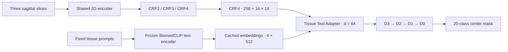

# 第二模块：内部组织文本融合（实现与验证）

> 2026-11-08 清理更新：按用户要求，本轮 checkpoint、日志、指标表及验证输出目录已删除；本文仅保留历史设计记录，旧实验已关闭。清理明细见 [internal_text_cleanup_20261108.json](internal_text_cleanup_20261108.json)，新版候选见 [分层文本混合设计](hierarchical_text_fusion_design_20261108.md)。


日期：2026-11-06。AI 辅助设计与实现。本文下方的验证记录与“尚未启动”状态保留为当日记录。**2026-11-07 更新：确认此前 CUDA 不可见由沙箱设备隔离造成；沙箱外 GPU 正常，CUDA 检查通过，三组正式筛查已在 GPU 3 启动。** 见[训练续跑记录](internal_text_training_20261107.md)。固定类别提示同时用于训练和推理。

**2026-11-08 结果：** 三组已全部完成。组织文本主mean Dice为80.2298%，相对原模型下降0.1207个百分点，未通过预设筛查。完整指标与逐类结果（实验产物已删除）。

## 设计依据与研究问题

第一模块 CRF 汇集相邻切片的空间信息；第二模块以固定组织描述提供条件特征，接在 **CRF4 → 文本适配器 → D3**。研究问题是：在保留三片 ContextUNet、原标注预算和原 MT 损失的条件下，解剖文本条件是否比无适配器以及中性文本条件带来更好的验证集分割。

- [Textmatch，MICCAI 2024，§2](https://papers.miccai.org/miccai-2024/paper/0960_paper.pdf)：参考其同构学生/教师和内部提示解码思路。本实现仅使用一个深层单向跨注意力适配器，没有复现其多层双向提示解码器、文本增强或对比损失。
- [SemiVL，ECCV 2024，§3.4](https://www.ecva.net/papers/eccv_2024/papers_ECCV/papers/05598.pdf)：参考保留类别文本语义锚点参与解码的思路。SemiVL 使用已有视觉语言对齐；这里的 U-Net 从零训练，投影必须通过分割任务学习。SemiVL 不归为纯 MT 方法。
- 其他上轮文献主要支持外部提示/伪标签路线，见[文献核查](multimodal_mt_integration_20261106.md)。本模块没有使用外部组织教师的预测、额外伪标签或任务训练后的 VLM 权重。

跨注意力、冻结文本编码和残差适配均已有先例。本实现是可验证的结构候选，不以新命名代替创新性证明。

## 具体结构



图为局部数据流；原有 E0/E1 中心片跳跃连接与 CRF2/CRF3 跳跃连接照常进入解码器。学生和教师各包含完整模块，教师全部可学习参数（包括文本投影与门）通过 EMA 更新。

输入 `F ∈ R^(B×256×14×14)`、固定文本向量 `T ∈ R^(4×512)`。实现先将 F 展平为 196 个图像位置，分别对图像和文本做 LayerNorm，再计算：

```text
Q = Wq LN(F)                 # 256 -> 64
K = Wk LN(T)                 # 512 -> 64
V = Wv LN(T)                 # 512 -> 64
A = softmax(Q K^T / sqrt(64))
Fout = F + tanh(g) Wo(A V)   # 64 -> 256; g starts at 0
```

这是单头注意力，没有额外 FFN 或新的损失。零门初始化使新增模型的初始 logits 与原三片模型完全一致；第一步先学习门，随后各投影接收梯度。`tanh(g)` 可为负，不是概率或“文本置信度”。注意力权重也没有直接的组织分类监督，不能当作已校准的组织概率或解释性分割图。

单个部署网络：原模型 5,688,640 参数，新模型 5,788,481 参数，增加 **99,841（1.755%）**。固定向量表 4×512 个 float32，即 8 KiB；这是 buffer，不计为可训练参数。文本编码器仅在离线导出时运行，训练和部署 checkpoint 都包含所需向量；每次预测仍需运行适配器。

## 提示与标签语义

沿用已核对的四条组织文本：

1. `Background and other tissues in a sagittal spine MRI.`
2. `Vertebrae in a sagittal spine MRI.`
3. `The spinal canal in a sagittal spine MRI.`
4. `Intervertebral discs in a sagittal spine MRI.`

中性对照为 `Region A/B/C/D in a sagittal spine MRI.` 的四个不同向量。两组使用同一个冻结 BiomedCLIP revision、相同向量维度及完全相同的可训练参数初始化。原 20 类输出头保留：组织文本不强制解释相对编号，也不声称某组织一定存在于当前切片。所有病例共享文本表。

**可识别性的限制：** 这里文本向量是通过可学习 K/V 投影使用的固定集合，没有逐类输出与某个文本 token 的强制绑定。文本组优于中性组只是第一阶段证据，仍可能与向量几何、初始化或优化有关；不能直接证明模型理解了解剖关系。若筛查通过，后续应增加保持 Gram 矩阵的随机正交旋转向量对照及多种子确认，再决定是否引入显式组织对齐目标。当前不叠加对齐损失，以便先判断结构本身。

同时重排 K、V 的 token 顺序在数学上不改变结果。因此“打乱四条提示的顺序”不是有效消融；本轮检查使用内容替换，并测试了这种排列不变性。

## 已完成的验证

1. **本地真实文本导出**：从项目固定的 BiomedCLIP revision `9f341de24bfb00180f1b847274256e9b65a3a32e` 提取 4×512 的归一化向量。未上传数据、未访问网络、未读取影像或标签。记录基础权重、tokenizer、配置与导出脚本的哈希。见[向量来源记录](../outputs/internal_text_banks_20261106/manifest.json)。
2. **37 项相关测试：33 通过、4 项 CUDA 测试跳过**。覆盖原 MT/上下文/推理回归、新模块梯度、EMA、初始输出一致性、输入内容依赖、token 集合排列不变性、缓存推理、精确断点恢复、无需外部 bank 的单教师部署，以及冻结三组实验流程的合成端到端运行。合成测试使用随机单位向量，作用是验证实现，不提供语义效果证据。
3. **真实训练批次 CPU 短测**：三组均使用 `[8,3,224,224]`、原 32 通道宽度、同一组 4 个有标注与 4 个无标注样本。每组仅更新 3 次，调度索引为 0、1、1801；跳到索引 1801 是检查调度路径，不代表训练了 1802 步。三组初始视觉参数和 logits 完全一致，两个适配器组可训练参数初始化完全一致。四个投影均有非零梯度，文本 buffer 未改变，教师无反传，单教师 checkpoint 输出与训练系统一致。见实测结果（实验产物已删除）。
4. **内容依赖**：三次更新后，在固定图像上改变向量坐标，text 组最大 logit 变化约 `1.64e-4`。这只说明计算路径使用了文本内容，不代表语义提升。由于仅训练三步，实际置信阈值下末步伪标签覆盖为 0；真实短测不构成有效无监督学习收益的证据。合成测试另以可接受目标验证了联合损失和 EMA 链路。
5. **禁用路径兼容性**：与历史冻结三片代码比较，split、真实输入和标签完全一致；在调度索引 0、601、1801 的三次诊断更新后，学生与教师参数逐位一致。见兼容性记录（实验产物已删除）。

没有读取 test 做开发或选择；真实短测没有计算 valid Dice。合成夹具验证的 Dice 不作为模型性能结果。CPU 回归通过不能替代 CUDA 数值与缓存一致性核验。

## 已固化的精度筛查

| 组别 | 第一模块 | 第二模块 | 文本 |
|---|---|---|---|
| context | 三尺度 CRF | 无 | 无 |
| neutral | 相同 CRF | E4 适配器 | Region A/B/C/D |
| text | 相同 CRF | E4 适配器 | 四类组织描述 |

共同配置：seed42，6000 步，batch8（4 L + 4 U），1496/3732 标注预算，224×224，AdamW 3e-4，原 CE/Dice 与 MT 置信度掩码 CE，预热 600 步、爬坡 1200 步；每 500 步评估完整原生 valid，选最优 EMA teacher，平分保留较早 checkpoint。三组都从头初始化视觉主干，未使用已有任务训练权重暖启动。

沿用首轮文本实验的候选筛查标准，避免看到结果后调整：text 相对 context 主 Dice 至少 +0.3 个百分点，相对 neutral 至少 +0.1 个百分点，且对两者的 union-present 均不下降。通过后才考虑多种子、更严格向量对照和推理耗时测量；本脚本不会自动追加确认实验。这个门槛是工程筛查规则，不是显著性检验。

已准备的目录为 `outputs/internal_text_screen_20261106/`，其中包含代码快照、三组 YAML、两个文本 bank、SHA256 清单与 protocol.json。状态为 `prepared`，**训练尚未启动**。正式运行固定快照，训练失败停止；断点恢复需显式 `--resume`。

CUDA 可用时从项目根目录启动已准备的三组筛查：

```sh
MPLCONFIGDIR=/tmp/ftp-internal-text-mpl /home/zhp/.conda/envs/mamba/bin/python experiments/run_internal_text.py --output outputs/internal_text_screen_20261106 --resume --device cuda:0
```

重新准备一个独立输出目录（不覆盖本轮快照）：

```sh
/home/zhp/.conda/envs/mamba/bin/python experiments/run_internal_text.py --output outputs/internal_text_screen_new --prepare-only
```

实现入口：[内部模块](../freqssl/internal_text.py)、[实验流程](../experiments/run_internal_text.py)、[真实数据短测](../experiments/check_internal_text.py)、[针对性测试](../tests/test_internal_text.py)。原主图尚未改为该候选结构，避免将已验证基线与待验证模块混在同一版本中。
