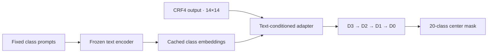

# 固定类别文本接入 Mean Teacher：定向文献核查与结构建议

日期：2026-11-06（Asia/Shanghai）。AI 辅助快速研究简报。用途是回答当前三片 ContextUNet 的文本接入位置；本次没有修改模型、启动训练或宣称新方案有效。

用户明确选择：**训练和推理都使用固定的类别文本提示**。因此本建议以网络内部的文本条件解码为主。固定类别文字提供语义先验；它们不携带每个病例额外的观察信息。

## 结论

优先试验 **CRF4 的融合输出 → 文本条件适配器 → 首级解码器 D3**。224×224 输入下，该处是 14×14、256 通道的中心片上下文特征。学生和 EMA 教师各自包含同构的可训练适配器；教师适配器随学生一起做 EMA 更新。

冻结一个医学文本编码器，为固定类别提示预计算并保存类别向量。两套网络可读取同一个只读向量表，推理无需逐切片重复运行文本编码器。每次分割仍要计算新增的图文融合层，不能将其开销记为零。

这是基于文献机制和当前模型的工程判断，不是已通过匹配实验的最优尺度结论。E4 的低分辨率便于先控制计算和变量；后续可与 E3、E3+E4 做消融。

## 检索与核验范围

定向检索使用 `mean teacher + text / text encoder / prompt + medical segmentation`、`CPS4`、`language-guided semi-supervised segmentation` 等组合，随后阅读会议官方 PDF、期刊正文和作者 arXiv 方法部分。纳入五篇用于比较接入机制的来源，不声称是系统综述或完整覆盖该领域。

两个主要问题是：提示是否直接参与部署网络预测，以及新增模块应处于特征、解码或伪标签路径。没有横向比较不同数据集、标注预算或预训练条件下的论文分数。

Semantic Scholar API 访问失败，记作 `[S2-API-UNAVAILABLE]`；使用官方全文与标题/版本信息核验，并按标题去重。SAM-Match 的期刊 DOI 已解析并与题目、作者匹配。VESSA 保留为预印本，不提升为已确认的会议或期刊发表。

## 五篇文献的机制证据

| 来源与阅读位置 | 已核对的机制 | 与当前任务的关系 |
|---|---|---|
| [Textmatch，MICCAI 2024，§2、PDF pp.3–5](https://papers.miccai.org/miccai-2024/paper/0960_paper.pdf) | 同构学生和教师均含视觉编码、文本编码、双向提示解码器与分割头；教师 EMA 更新；解码侧进行图文融合。 | 直接支持在两套网络的解码路径接文本，是本次最贴近的结构参考。 |
| [CPS4，MICCAI 2026，§2.1–2.2、PDF pp.4–5](https://papers.miccai.org/miccai-2026/paper/0946_paper.pdf) | 先做类别与脊柱区域对齐的 VLM 预训练，再生成类别引导分割图，向 MT 提供额外监督并增强伪标签。 | 文本主要作用于外部指导路径，不要求 MT 的内部解码器直接读取文本。其 MRSpineSeg 类别定义不能直接替换当前 SPIDER 相对编号。 |
| [SAM-Match，Medical Physics 2025，§3.2–3.5、Algorithm 1](https://pmc.ncbi.nlm.nih.gov/articles/PMC12149692/) | EMA 教师的预测生成点或框，SAM/MedSAM 得到分割目标后指导学生；包含预热和交互阶段。 | 说明空间提示可以接在伪标签细化路径。论文实现是 Match 系列与 EMA 教师结合；它不提供文本融合模块。 |
| [VESSA，2025 提交、2026-08-17 修订的 v3 预印本，§III-A–III-B](https://arxiv.org/html/2511.19759v3) | 文本结合带标签模板形成外部参考式辅助教师；通过蒸馏补充 SSL；包括 MT 接入，主描述采用 UniMatch v2。 | 提示不局限于类名，还可结合少量授权参考实例；属于外部辅助路线。 |
| [SemiVL，ECCV 2024，§3.1、3.4、PDF pp.5–8](https://www.ecva.net/papers/eccv_2024/papers_ECCV/papers/05598.pdf) | 类名嵌入作为语义锚点，图文相似度图进入语言引导解码器；基于 UniMatch 式一致性训练。 | 是固定类别文本参与解码的相邻参考，不把它归为纯 MT 模型；其视觉语言预训练已提供对齐，当前从零训练的 U-Net没有这一条件。 |

以上证据支持存在两类接入：网络内部条件解码，以及训练期外部目标生成。不能从这五篇定向来源推断所有 MT 论文的普遍比例，也不能据其论文结果保证 SPIDER 收益。

## 当前主干的具体接法（待验证设计）

这张局部结构各放入学生和教师一份。第一轮仅在 E4 接入轻量跨注意力适配器：图像位置作查询，分别保留的类别文本向量作键和值，输出通过残差校正视觉特征。不会把所有类别文本先平均成一个常量向量。文本编码器冻结；学生的投影层、适配器、编码解码主干通过现有监督和伪标签损失学习，教师的可学习部分由 EMA 更新。

此处跨注意力/条件解码本身已有文献先例，图中增加命名模块不构成独立创新性证据。建议先保留当前损失，识别结构改动的作用，再按结果决定是否引入额外图文一致性目标。

**图文对齐是关键变量。** 当前视觉主干从零训练，不能直接假定其特征与 BiomedCLIP 等模型的文本向量处于同一语义空间。需用授权标注训练视觉/文本投影与融合层，并检查有效的图文对应是否形成。固定文本在所有病例相同，不提供病灶有无、器官存在或实际编号等病例事实；这些仍需由影像判断。

**类别定义必须匹配。** 当前组织提示对应背景、椎体、椎管、椎间盘；九级椎体/椎间盘相对编号不自动具有 L1、L2 等绝对解剖意义。可以先以可信组织语义提供条件特征，让 20 类视觉输出头学习精细编号；若采用 20 类文本，应先核对每条文本与真实标签语义。

## 已有实验对建议的约束

- [首轮三组结果](../outputs/spine_prompt_context_20261103/report.md)：邻片对照 80.3505%，文本外部教师 80.2212%，中性提示教师 80.4033%；均为单种子、6000 步 valid 主 Dice。文本组没有通过筛查。
- [第二轮核验](../outputs/spine_prompt_revision_20261104/review_20261106/report.md)：多提示教师的组织分割有所改善，但补充指导覆盖不足，正式学生 S1–S4 没有启动。不能把此轮解释为已经验证内部文本融合，也不能说所有文本方法无效。

这些本地证据使本次优先级转向内部特征语义融合，而非直接重复同一个外部组织教师方案。优先级是研究选择，不等于内部方案已经优于外部方案。

## 最小判别实验建议

先比较当前无文本 MT、同一适配器配中性提示、同一适配器配真实解剖提示。对照应控制预训练来源、可训练容量、训练预算和数据。通过后再比较 E4、E3、E3+E4 的接入位置。报告主 Dice、union-present 和新增参数/耗时；将语义收益与增加参数或额外预训练的收益区分开。

## 参考文献

1. Li, A., Zeng, X., Zeng, P., Ding, S., Wang, P., Wang, C., & Wang, Y. (2024). *Textmatch: Using text prompts to improve semi-supervised medical image segmentation*. MICCAI. [官方全文](https://papers.miccai.org/miccai-2024/paper/0960_paper.pdf)
2. Pan, Q., Sun, H., Ji, B., & Li, S. (2026). *CPS4: Class prompt driven semi-supervised spine segmentation with class-specific consistency constraint*. MICCAI. [官方全文](https://papers.miccai.org/miccai-2026/paper/0946_paper.pdf)
3. Xu, G., Qian, X., Shao, H.-C., Luo, J., Lu, W., & Zhang, Y. (2025). *A segment anything model-guided and match-based semi-supervised segmentation framework for medical imaging*. Medical Physics, 52(6), 4513–4527. [DOI](https://doi.org/10.1002/mp.17785)
4. Guo, J., Li, M., Su, H., Healy, K., Fan, L., Tavakoli, N., López-Tapia, S., Kim, D., & Katsaggelos, A. K. (2026). *Vision-language enhanced foundation model for semi-supervised medical image segmentation* (arXiv:2511.19759v3; original submission 2025, revised August 17, 2026). [版本与作者信息](https://arxiv.org/abs/2511.19759v3)
5. Hoyer, L., Tan, D. J., Naeem, M. F., Van Gool, L., & Tombari, F. (2024). *SemiVL: Semi-supervised semantic segmentation with vision-language guidance*. ECCV. [官方全文](https://www.ecva.net/papers/eccv_2024/papers_ECCV/papers/05598.pdf)
