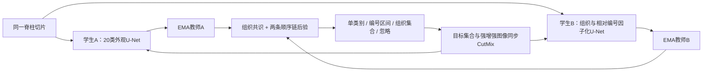

# OAR-Spine：用顺序证据选择监督粒度的双学生脊柱分割模型

## Material Passport

- Origin Skill: academic-research-suite / experiment-agent，设计与实现按用户目标自主推进。
- Origin Date: 2026-10-27
- Version Label: oar_spine_v1
- Verification Status: 原型与无标签推理已验证；v1顺序机制未通过预设的单种子性能筛查，不能宣称该机制有效。
- 材料：本地冻结实验、已标注训练标签、valid诊断、公开原始论文；未向外部服务上传图像或未公开材料。
- 当前阶段：候选设计 → 实现验证 → 预设消融筛查。保留“设计有新颖性的脊柱半监督模型”的完整目标，不将启动成功当成目标完成。

## 研究问题与证据

研究问题：当双教师对组织形状、相对编号的可靠性不同，能否通过整幅图的顺序证据选择可监督的标签集合，减少错误确认，同时保留不确定区域的可用信息？

此前三组200轮训练均未超过各自6000步结果，后100轮未刷新valid最佳。新的诊断使用valid，不再次读取test。原频率双学生valid原生网格上，高置信前景（max概率≥0.8）的错误率为：短训最佳10.24%、长训最佳9.08%、200轮末尾11.84%。前景错误中同组织但错误编号的比例分别为3.79%、3.62%、6.77%。**编号错误不是主要误差，不能把长训失败完全归因于编号漂移。** 新机制同时检查组织共识与编号证据。

已有标注的1496张训练切片单独审计：椎体1..9有20,069个共现类对、盘11..19有16,154个类对，沿张量最后一轴均保序；完整交替链却有22个逆序类对。131张全背景，579张缺失可见端点间的某些类。因此分别建椎体、椎间盘两条可跳级链，不强迫18类交替或全部出现。原始[SPIDER论文](https://pmc.ncbi.nlm.nih.gov/articles/PMC10908819/)明确编号不能固定解释为L5等绝对解剖节段；本设计仅使用相对编号。

证据路径：`outputs/spine_design_20261027/validation_error_audit.json`、`data_audit/audit.json`、`data_audit/report.md`。

## 架构

OAR = Ordinal Ambiguity Routing，工作名称，不代表已发表方法。



学生A保留现有20类U-Net、初始化与推理接口。学生B使用同规格独立U-Net，但解码为四类组织（背景、椎体、椎管、盘）和两组9类条件编号：

`P_B(c|x) = P_B(g(c)|x) × P_B(c|g(c),x)`。

背景和椎管不需要编号条件。两组编号logit融合局部解码特征与沿上下轴的全局上下文；沿横轴和轴向块平均到最多28个位置，4层膨胀Conv1d，再以确定性块展开恢复轴长度。局部编号logit仍保留空间细节。教师分别EMA更新，不跨网络平均参数。

主推理使用教师A，仍只需一个普通20类U-Net。教师B、顺序链与监督选择只增加训练成本；不通过推理时硬重编号提升分数。学生B本身也输出归一化20类分布，供一致的辅助评估。

## 顺序证据与目标集合

在两位教师的完整弱增强图像上，分别对椎体、盘构建相对编号剖面：横轴平均，沿上下轴降到56个位置；按同组织总概率归一化成9类条件分布，组织支持不足的行降低发射分数权重。翻转轴向后，状态从尾侧小编号向头侧大编号递增。

单调CRF的状态允许停留、向前和跳级；起始/终止状态不固定，不要求编号1或9出现：

`P(z|x) ∝ exp(Σ_t e_t(z_t) + Σ_t A(z_(t-1),z_t))`。

`A(i,j)=0 (j=i); -1.5-2×max(j-i-1,0) (j>i); -∞ (j<i)`。

用log-space forward/backward求边缘后验，不取最大路径作为“真标签”。这些后验是顺序模型下的证据，不是已校准的正确概率。无组织支持行仍受到路径先验影响，不能声称其后验均匀或含有图像证据。

每个像素依次选择：

1. 组织共识不足：忽略。两教师都须达到组织置信度0.8；背景0.95。
2. 两教师细类一致且各自细类概率≥阈值，且两条对应链在该类的后验≥0.5：监督单类别。
3. 同组织、编号分歧跨度≤3，双方概率和双方链后验在候选区间内的质量均≥0.8：监督该连续编号集合。
4. 其余组织可信但编号不可信的像素：只监督完整组织集合。

先选集合再CutMix。集合的20个二值通道和1个权重通道与图像用完全相同的供体/矩形混合；不在拼接后的假脊柱上推断顺序。

## 训练目标

每个学生的标注目标为：

`L_l = 0.5 CE_20 + 0.5 Dice_20 + 0.25 × (0.5 CE_tissue + 0.5 Dice_tissue)`。

未标注目标是允许集合的边缘似然：

`L_u = -(1/N) Σ_v w_v log Σ_(c∈C_v) P(c|x_s)_v`。

`L_total = Σ_(i=A,B) [L_l^i + λ(t)L_u^i]`，背景权重0.25，拒绝像素权重0，分母始终为所有像素。λ前600步为0，随后1200步线性上升到1。没有沿用Dice或区域Gram辅助损失。

单类别集合退化为CE；全组织集合仅约束组织总概率。对学生B，纯组织集合目标对条件编号logit的梯度为0，因而不会把“不知道是哪个编号”变成任意硬编号。教师和目标集合全部detach。

这一设计不能解决两个教师共同自信且整体平移一个编号的错误；这样的平移仍可能满足顺序约束。也不能从部分视野中恢复原本不可辨识的绝对解剖节段。

## 与既有工作的区别及检索边界

检索日期2026-10-27；检索范围是可访问的原论文、作者仓库和出版页面，不是穷尽性系统综述。检索词覆盖frequency segmentation、hierarchical pseudo labels、spine order、candidate-set ambiguity、semi-supervised vertebra identification。

| 既有方法 | 已有内容 | 本候选设计需要验证的区别 |
|---|---|---|
| [CPS](https://arxiv.org/abs/2106.01226) | 两分割网络互相提供硬伪标签 | 从单一硬标签改为受组织与顺序证据控制的候选集合 |
| [XNet](https://github.com/Yanfeng-Zhou/XNet)、[XNet v2](https://arxiv.org/abs/2409.00947) | 小波分支、频率互补与一致性 | 两学生的区别来自标签因子化，不将频率分解作为贡献 |
| [FRCNet](https://arxiv.org/abs/2405.16573) | 频域一致性与多粒度区域关系 | 结构证据决定监督到哪一级，而非再约束区域特征相似性 |
| [HierMatch](https://arxiv.org/abs/2111.00164) | 以类别层级利用粗粒度标签 | 面向密集脊柱分割，顺序后验动态决定像素监督集合，无额外粗标签 |
| [图优化与解剖一致性循环](https://arxiv.org/abs/2110.12177) | 利用脊柱结构进行定位、分割、编号一致性优化 | 不用最优结构路径修正最终编号，而将结构不确定性用于训练目标粒度 |
| [Semi-Supervised Vertebra Segmentation and Identification，2026](https://www.mdpi.com/2379-139X/12/3/33) | CT分割/编号多任务、teacher-student、置信过滤和序列后处理 | MRI的双标签空间学生；链后验参与半监督集合目标，无推理后处理 |
| [AmbiSSL，CVPR2025](https://openaccess.thecvf.com/content/CVPR2025/papers/Kumari_Annotation_Ambiguity_Aware_Semi-Supervised_Medical_Image_Segmentation_CVPR_2025_paper.pdf) | 多decoder与潜变量表达标注歧义、多种分割假设 | 本方法表达的是相对编号不可辨识与监督信息量，不宣称首次处理医学分割歧义 |

可提出的**候选贡献**是“以脊柱相对顺序后验控制层级候选集合的双学生训练”，而非双学生、层级损失或链模型本身首次出现。当前未找到与这一完整机制完全一致的来源，但这不证明全球首创，也不等于达到论文新颖性门槛。

## 已完成的机制诊断

固定旧200轮双教师，在valid的224×224网格上对同一批输出比较（与前面的原生网格统计分开）：

| 监督规则 | 细粒度前景数 | 细粒度错误率 | 所有前景集合数 | 集合排除真类比例 |
|---|---:|---:|---:|---:|
| 原高置信硬标签 | 1,094,283 | 7.733% | 1,094,283 | 7.733% |
| 仅组织/层级共识 | 1,046,101 | 6.064% | 1,066,855 | 6.316% |
| 加顺序证据 | 1,020,071 | 5.883% | 1,066,855 | 6.276% |

顺序机制进一步把26,030个细粒度监督转为更粗粒度，细类错误率下降，但也减少了正确细类监督。全组织集合比单类别更容易包含真类，因此集合包含率不是可与分割Dice直接比较的指标。相较仅层级共识，结构部分的净集合有效性改进较小，必须靠消融验证其价值。该探针仍使用旧同构教师，不能证明新异构学生训练收益。所有阈值在运行探针前固定，没有据此搜索新阈值。

## 预设实验

三组各6000步、seed42、同一S1初始化/数据批次/增强种子/优化器/验证时点；不新增单学生对照。

| 组 | 学生架构与标注损失 | 未标注规则 | 要回答的问题 |
|---|---|---|---|
| hard_peer | A平坦+B因子化，含组织标注目标 | 原互相硬CE | 异构架构与组织学习是否可用 |
| hierarchy | 相同 | 共识与层级集合，无顺序链 | 集合监督有无帮助 |
| ordinal | 相同 | 完整顺序后验路由 | 顺序证据是否有增量作用 |

主指标固定教师A完整21例原生3D valid逐例前景Dice；次指标组织Dice、编号混淆、各粒度覆盖/错误率、耗时/显存。每500步验证，与历史筛查的选模频率相同，按valid选checkpoint。现有单学生/原双学生6000步只作历史参考；新三组间控制其他因素一致。首次筛查不自动读test，不将某个辅助网络的较高test换成主指标。三组未单独分离异构结构、额外组织标注目标、学生数量的影响，不能据此分别宣称这些组件有效。

筛查只检验候选：ordinal至少优于同预算hierarchy及hard_peer才能支持结构机制继续；优势若不足0.3个百分点，视为弱信号而非可靠改进。0.3pp是实用筛查门槛，不是统计显著性阈值。之后需要多个种子、患者隔离的划分和未用于开发的评估集，才能判断稳定收益。历史test已多次查看，不能再把它当完全未接触的最终确认集。

```sh
/home/zhp/.conda/envs/mamba/bin/python experiments/launch_ordinal.py \
  --config configs/v3/dual_ordinal.yaml --gpus 0 1 2 \
  --output-dir /data1/zhp/ftp_next_runs/spine_ordinal_20261027
```

运行代码先冻结；只核实启动，不持续监控，不自动开启新单学生训练。

## 实现验证及数据限制

实现：`freqssl/anatomy.py`、`ordinal_model.py`、`ordinal_training.py`；配置：`configs/v3/dual_ordinal.yaml`。单调后验与穷举路径比较、集合loss梯度、无标签泄漏接口、教师冻结、CutMix对齐、初始化与checkpoint往返均有测试。原型8步真实224²/batch8短测完成并跑完21例valid，短测Dice不用于评估性能。首次短测暴露torch2.0 CUDA linear1d反向不支持严格确定性，已改用块均值与块展开，保留原失败日志。

启动时有两项未解决的数据问题：旧PNG转换用GT类别质心决定上下翻转；重命名编号到原患者/序列的映射未知。随后完成了影像来源审计：210个转换体积均与原始T2影像逐体素匹配，168/21/21名患者之间无交叉；22个体积的轴置换导致原header的spacing/direction不正确，已生成独立的可信几何清单。患者身份依据原始数据的study ID，原始发布说明为218个study对应218位患者，见[SPIDER原始发布](https://zenodo.org/records/10159290)。本地审计仅覆盖本仓库使用的210例，不等于所有SPIDER版本或其他划分已审计。

`predict_spine.py` 现可只读取影像及可信几何，推理后还原原始空间，不读取标签。210例/4631张切片的几何、灰度转换及224²归一化模型输入与旧PNG完全一致；两例真实训练影像的原始MHA、转换MHA、PNG预测在新入口的严格FP32模式下标签一致。详见 [无标签推理与来源审计](spine_label_free_inference_20261028.md)。这些证据解决了当前数据上方向预处理必须读取标签的问题；冻结训练仍保留旧PNG路径与原验证协议，不回写或改动既有实验。

独立测试、多种子稳定性及临床适用性仍未验证。当前slice级标注预算的标注/未标注池共享训练患者，这与train/valid/test患者隔离是两个不同问题。

本次成果是有明确差异点、可运行、可证伪的候选模型。性能增益与创新价值仍由后续证据决定。

## 运行记录

2026-10-27 17:10（Asia/Shanghai）启动三组6000步筛查：hard_peer/GPU0/PID852316，hierarchy/GPU1/PID852317，ordinal/GPU2/PID852318。物理输出 `/data1/zhp/ftp_next_runs/spine_ordinal_20261027`，仓库入口 `outputs/spine_ordinal_20261027`。源码冻结在该运行的 `code/`，各组配置、日志和PID见 `launch.json`。完整freqssl测试51项通过；三组实际GPU重复3步得到相同参数哈希；CPU/GPU的2+2步续训与4步连续训练的全部学生/教师状态和日志完全相同。凭据 `outputs/spine_design_20261027/gpu_full_suite.log`、`gpu_checks.json`。

## 2026-10-28筛查结论

三组均完成6000步；验证最佳均在4500步。按预设teacher1主指标，test Dice依次为78.978%、78.762%、78.436%，均低于历史同预算单学生79.244%。顺序模型相对层级组仅增加0.041pp valid，低于预设0.3pp筛查门槛，test下降0.326pp。**v1的顺序路由没有获得所需收益，不能作为已验证贡献。** 完整结果见 [首轮消融报告](../outputs/spine_ordinal_test_20261028/report.md)。

同一checkpoint的双教师均值约80.1%，是使用两网络的辅助结果，不能替换预设主指标，也不能归因于顺序链。完整valid的224²机制诊断显示，两教师各自独有的正确前景约2.3%—3.3%；对完整顺序模型输出增加链条件仅将候选集合排除真类的比例由3.886%降至3.870%，同时减少13,021个细类监督像素。链提供的信息很少；集合包含率改善不代表分割提升。这些观察支持进一步研究两路互补的有效传递，不支持盲目增加顺序损失或训练轮数。
